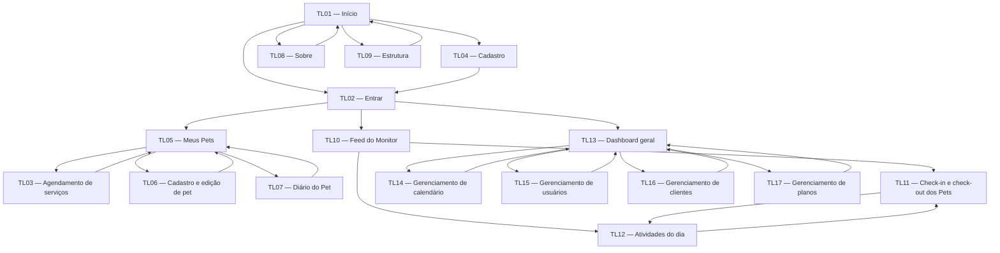

# EcoDog Park — Especificação de Design de Interface

## Visão geral

**Produto:** Agenda de aula de pets — EcoDog Park  
**Plataforma:** aplicação web responsiva, mobile-first, para smartphone Android e desktop.  
**Público-alvo:** tutores de pets, monitoras/cuidadoras e proprietária/administradora.

### Problema
O agendamento das aulas/serviços dos pets por meio de fichas em cartões desacelera a produtividade e provoca erros manuais.

### Proposta de valor
Gerir os agendamentos de forma mais fácil e ágil, reunindo informações de pets, rotina, serviços e gestão em uma interface responsiva.

### Escopo de produto
O sistema contempla páginas institucionais públicas, autenticação e cadastro, recursos da tutora para pets/agendamentos/diário, recursos da monitora para rotina e check-in/check-out e recursos administrativos para indicadores, calendário, usuários, clientes e planos. O acesso às áreas restritas depende do perfil e das permissões.

### Direção visual
Identidade divertida, amigável, energética e colorida. Priorizar hierarquia clara, consistência entre telas, legibilidade e equilíbrio entre personalidade e usabilidade. A interface deve respeitar as fontes Luckiest Guy, Lilita One e Roboto definidas no documento de identidade visual.

## Instruções de implementação para OpenCode + Pencil.dev

**Objetivo deste documento:** orientar um agente de código a implementar a interface EcoDog Park em React + Vite, usando o arquivo `.pen` aberto/lido pelo Pencil.dev como referência visual primária.

### Hierarquia das fontes de verdade
1. **Arquivo `.pen` do protótipo no Pencil.dev:** referência primária para composição, dimensões relativas, alinhamentos, ordem visual, espaçamentos, ícones, imagens, cores, tipografia, bordas, sombras, estados e variantes. Inspecionar os frames e componentes existentes antes de escrever código.
2. **Imagens de alta resolução do pacote `Protótipo.zip`:** referência visual complementar para comparar os frames e conferir estados e versões desktop/mobile.
3. **Planilha de briefing e esta especificação:** fonte para escopo, personas, copy, requisitos, permissões, estados e navegação.
4. **Wireframes de baixa fidelidade:** referência complementar para estrutura e fluxo quando um detalhe não estiver representado nas imagens de alta resolução.

Se houver divergência visual entre este texto e o frame correspondente no `.pen`, seguir o `.pen` para a apresentação visual e registrar a divergência em vez de inventar uma solução. Se houver divergência de escopo ou regra de negócio, não inferir: manter o que estiver documentado no briefing e registrar a lacuna.

### Regras para o agente de código
- Antes de implementar, inspecionar o projeto React + Vite existente e reutilizar sua estrutura, rotas, estilos, componentes e convenções; não recriar o projeto nem substituir arquivos sem necessidade.
- Implementar as telas por ID (`TL01` a `TL17`) e manter os nomes/IDs rastreáveis no código ou nos comentários de organização.
- Comparar cada tela implementada com o frame correspondente do `.pen` em viewport equivalente. Não “modernizar”, simplificar, rearranjar ou redesenhar elementos por preferência própria.
- Reutilizar componentes e tokens compartilhados; não duplicar variantes visualmente idênticas.
- Usar a copy documentada na planilha quando ela existir. Não usar `lorem ipsum`, textos genéricos de preenchimento ou mensagens inventadas como se fossem copy aprovada.
- Não criar funcionalidades, campos, ações, rotas, dados, regras de validação ou estados que não estejam no briefing, no `.pen` ou nas telas anexadas.
- Quando um detalhe não puder ser confirmado, manter a implementação no limite do que está documentado e registrar em `## Lacunas do briefing`.
- Não considerar imagens de estados, modais, comparações ou formulários como novas páginas sem evidência de que são uma tela navegável.
- Preservar os requisitos de acessibilidade deste documento sem alterar a hierarquia visual do protótipo; se o protótipo conflitar com um critério de acessibilidade, registrar a divergência e aplicar a solução acessível menos invasiva possível.

### Inventário das referências visuais de alta resolução
Os arquivos abaixo vieram de `Protótipo.zip`. Os nomes são preservados como recebidos; são referências visuais, não substituem o arquivo `.pen`.

| Tela / contexto | Arquivo(s) de referência |
|---|---|
| TL01 — Início institucional | `Institucional - Inicio.png` |
| TL02 — Entrar | `Institucional - Login.png` |
| TL03 — Agendamento de serviços | `TL03 • Agendamento • Desktop.png`; `Confirmação de agendamento • Desktop • Nova versão.png`; `Confirmação de agendamento • Mobile • Nova versão.png` |
| TL04 — Cadastro de usuário | `Institucional - Cadastro.png` |
| TL05 — Meus Pets | Não foi identificado um frame de alta resolução inequivocamente correspondente no pacote recebido. Conferir o `.pen` e registrar a correspondência. |
| TL06 — Cadastro e edição de pet | `Cadastro Pet.png`; `Editar Pet.png`; `Pop-Up Alergias.png`; `Pop-Up Alergias 2.png`; `Pop-Up Alergias 3.png`; `Pop-Up Alergias 4.png` |
| TL07 — Diário do Pet | Não foi identificado um frame de alta resolução inequivocamente correspondente no pacote recebido. Conferir o `.pen` e registrar a correspondência. |
| TL08 — Sobre | `Institucional - Sobre nós.png` |
| TL09 — Estrutura | `Institucional - Nosso espaço.png` |
| TL10 — Feed do Monitor | `Estados do Feed do Monitor.png` |
| TL11 — Check-in e check-out dos Pets | `Check-in e Check-out dos Pets.png` |
| TL12 — Atividades do dia | `Atividades do Dia.png`; `Estados Atividades do Dia.png` |
| TL13 — Dashboard geral / metas e receitas | `Administração • Metas e receitas • Desktop • Nova versão.png`; `PopUps Metas e Receitas e Estados.png`; `TL13 • Editar meta • Estado inicial.png`; `TL13 • Editar meta • Meta carregada.png` |
| TL14 — Gerenciamento de calendário | `GErenciamento de Calendário.png`; `Calendário estados e comparações.png`; `04 • Administração _ Calendário + gestão de usuários.png` |
| TL15 — Gerenciamento de usuários | `Gerenciamento de usuário.png`; `Criar usuário.png`; `Editar usuário.png`; `Usuário estados e formularios.png`; `04 • Administração _ Calendário + gestão de usuários.png` |
| TL16 — Gerenciamento de clientes | `Gerenciamento de clientes.png` |
| TL17 — Gerenciamento de planos | `TL17 • Gerenciamento de planos • Desktop.png`; `TL17 • Gerenciamento de planos • Desktop (1).png` |
| Assistente / elemento complementar | `09 • EcoMigo _ Assistente desktop e mobile.png` — não foi possível associá-lo a um ID de tela na planilha; não criar uma nova tela com base apenas neste arquivo. |

**Observação sobre o pacote:** há imagens com nomes descritivos, versões alternativas e estados, mas não há correspondência explícita por ID para todas as telas. O arquivo `.pen` deve ser consultado para confirmar o mapeamento e identificar frames não cobertos pelo pacote de imagens.

---

## Persona

### P01 — Viviane Vieira
- **Perfil:** 23 anos, tutora de pets; familiaridade digital intermediária; usa principalmente smartphone Android.
- **Contexto e objetivos:** resolve tarefas pelo celular e quer marcar/remarcar estadias sem depender do horário comercial.
- **Dores:** tem poucas informações sobre como o pet está durante a estadia.
- **Frase:** “Quero ter certeza de que meu pet está seguro e sendo bem cuidado, mesmo quando não estou por perto.”
- **Implicações de design:** fluxo mobile-first; ações de agendamento e cadastro de pet fáceis de localizar; dados de cada pet claros; acesso direto ao diário e às informações disponíveis; mensagens acolhedoras para confirmar ações e explicar erros.

### P02 — Mariana Souza
- **Perfil:** 31 anos, adestradora/cuidadora; familiaridade digital intermediária; usa smartphone Android durante uma rotina de trabalho das 7h às 17h.
- **Objetivos e dores:** consultar informações rapidamente e garantir cuidados corretos; precisa acompanhar muitos pets ao mesmo tempo e evitar esquecer cuidados.
- **Frase:** “Preciso garantir que todos os pets estejam seguros e recebam os cuidados corretos durante o dia.”
- **Implicações de design:** priorizar leitura rápida, identificação inequívoca dos pets, tarefas e estados; minimizar etapas para registrar check-in/check-out e concluir atividades; diferenciar visualmente pendências, conclusões e alertas sem depender apenas da cor.

### P03 — Sandra Macedo
- **Perfil:** 40 anos, proprietária; familiaridade digital iniciante; usa principalmente notebook.
- **Objetivos e dores:** acompanhar desempenho e finanças, organizar informações de pets, medicações, alergias, vínculos e planos; precisa melhorar a comunicação e a tomada de decisão.
- **Frase:** “Preciso acessar rapidamente as informações dos pets como medicação, alergias, relacionamento com outros pets e acompanhar o desempenho do meu negócio, incluindo receitas e planos ativos, para facilitar a gestão e a tomada de decisões.”
- **Implicações de design:** priorizar hierarquia administrativa, tabelas legíveis, rótulos explícitos, ações de edição/ativação fáceis de reconhecer e navegação lateral consistente; como a familiaridade digital é iniciante, evitar controles ambíguos e oferecer confirmações claras.

## Design Tokens

### Cores

Usar os HEX e contrastes documentados na aba **Paleta de Cores** da planilha. Os nomes abaixo são aliases de tokens para uso nos componentes.

| Token | HEX | Papel | Contraste documentado |
|---|---|---|---|
| `cor-fundo-suave` | `#ADD9CC` | Fundos suaves, cards, áreas secundárias e seleção suave | `3.75:1` com `#1F653D` (conforme planilha) |
| `cor-primaria` | `#1F653D` | Títulos, botões principais, cabeçalhos, navegação, bordas de destaque | `6.97:1` com `#FEFEFE` |
| `cor-secundaria` | `#3C816F` | Ícones, elementos de apoio, estados intermediários e destaques secundários | Não informado |
| `cor-acao-positiva` | `#49812F` | Ações, estados ativos, indicadores positivos e elementos selecionados | `4.66:1` com `#FEFEFE` |
| `cor-alerta` | `#CB8335` | Destaques secundários, badges, categorias e atenção | `6.84:1` com `#000000` |
| `cor-erro` | `#CD492B` | Alertas, erros e ações que exigem atenção | `4.54:1` com `#FEFEFE` |
| `cor-superficie` | `#FEFEFE` | Superfícies, campos de entrada e texto sobre fundos escuros | Não informado |
| `cor-texto` | `#000000` | Texto principal/secundário conforme a planilha | Não informado |
| `cor-texto-invertido` | `#FEFEFE` | Texto sobre cores escuras quando o contraste estiver validado | Não informado |
| `cor-borda` | `#1F653D` | Bordas de componentes de destaque | Não informado |

**Nota de contraste:** manter os pares documentados quando aplicáveis e verificar cada combinação final. A planilha indica mínimo de 4,5:1 para texto normal e 3:1 para texto grande. Não usar a cor como único meio de comunicar status; combinar cor com texto, ícone ou forma.

### Tipografia

A identidade visual define Luckiest Guy para títulos principais, Lilita One para títulos secundários e elementos de interface, e Roboto para conteúdo corrido e texto auxiliar. A planilha também contém uma tabela de tokens tipográficos alternativa com Inter para H1; há divergência entre as fontes e deve ser confirmada em **Lacunas do briefing**. Para preservar a identidade visual auxiliar, a tabela abaixo segue as funções e escalas do documento de identidade visual.

| Token | Fonte | Peso | Desktop | Mobile | Altura de linha |
|---|---|---:|---:|---:|---|
| `tipo-h1` | Luckiest Guy | Regular | 40 px | 32 px | Não especificada |
| `tipo-h2` | Luckiest Guy | Regular | 32 px | 26 px | Não especificada |
| `tipo-h3` | Lilita One | Regular | 24 px | 22 px | Não especificada |
| `tipo-h4` | Lilita One | Regular | 20 px | 18 px | Não especificada |
| `tipo-card` | Lilita One | Regular | 18 px | 16 px | Não especificada |
| `tipo-botao` | Lilita One | Regular | 16 px | 16 px | Não especificada |
| `tipo-label` | Lilita One | Regular | 14 px | 14 px | Não especificada |
| `tipo-corpo` | Roboto | Regular | 16 px | 16 px | Não especificada |
| `tipo-auxiliar` | Roboto | Regular | 14 px | 14 px | Não especificada |

Usar Luckiest Guy preferencialmente em tamanhos maiores e, quando apropriado, com contorno, sem prejudicar a legibilidade. Não aplicar fontes expressivas indiscriminadamente em textos longos.

### Espaçamento

A planilha não especifica escala de espaçamento. Para a composição inicial, adotar uma escala provisória baseada em múltiplos de 4 px; validar com os wireframes antes da implementação.

| Token | Valor | Uso recomendado |
|---|---:|---|
| `espaco-4` | 4 px | Separação mínima entre ícone e texto |
| `espaco-8` | 8 px | Espaçamento interno compacto |
| `espaco-12` | 12 px | Agrupamento de elementos relacionados |
| `espaco-16` | 16 px | Padding de campos e cards compactos |
| `espaco-24` | 24 px | Separação entre blocos |
| `espaco-32` | 32 px | Separação entre seções |
| `espaco-40` | 40 px | Respiro de seção |
| `espaco-48` | 48 px | Respiro amplo em desktop |

### Raio de borda e sombras

| Token | Valor | Aplicação |
|---|---|---|
| `raio-pequeno` | A definir | Campos, badges e controles compactos |
| `raio-medio` | A definir | Cards e botões |
| `raio-grande` | A definir | Modais e contêineres de destaque |
| `sombra-card` | A definir | Elevação discreta de cards, somente se compatível com o wireframe |
| `sombra-modal` | A definir | Separação de modal em relação ao fundo |

Valores de raio e sombra não constam no briefing; não assumir valores finais até validação.

### Grid e responsividade global
- Estratégia **mobile-first**, conforme identificação do projeto.
- As telas estão indicadas como “Mobile e desktop”; não há breakpoints numéricos definidos.
- Em mobile, empilhar colunas e converter tabelas administrativas em apresentação legível por item/cartão quando necessário, preservando todos os campos e ações.
- Em desktop, usar a largura disponível para navegação lateral, tabelas e painéis sem comprometer a hierarquia.
- Breakpoints exatos, largura máxima de conteúdo e número de colunas devem ser definidos após validação dos wireframes.

## Tom de Voz

### Atributos
- **Acolhedor:** falar como um atendente atencioso, sem jargão técnico ou formalidade excessiva.
- **Informal:** usar proximidade e linguagem natural, mantendo clareza.
- **Alegre:** manter energia amigável e positiva, sem tornar mensagens operacionais confusas.

### Regras de escrita
- Preferir frases curtas, diretas e específicas.
- Explicar o que aconteceu e, quando possível, o próximo passo.
- Em confirmações, reconhecer a ação realizada.
- Em erros, não culpar a pessoa; explicar o problema em linguagem simples.
- Em estados vazios, explicar a ausência de conteúdo e oferecer somente uma ação prevista no escopo.
- Não usar jargões técnicos nem mensagens secas.
- Não corrigir nem substituir a copy final fornecida pela planilha. O único texto de interface final explicitamente fornecido está listado na tela TL01; os demais textos específicos de telas precisam ser confirmados.

| Contexto | Faça | Não faça |
|---|---|---|
| CTA / botão | “Agendar agora” | “Marque nova aula aqui” como substituição genérica quando o destino exige ação específica |
| Confirmação | “Pronto! Aula agendada para segunda, 28/09, 10h” (exemplo da planilha; adaptar apenas quando houver dados reais) | “Dia marcado para 28/09, as 10h” |
| Sucesso | “Novo ‘auluno’ cadastrado, será muito bom ter ele conosco” (exemplo literal da planilha; revisar ortografia antes de adotar como copy final) | “Pet cadastrado com sucesso” |
| Erro | Explicar em linguagem simples o que não foi concluído e como corrigir, sem inventar causa | “Erro 500” ou mensagem técnica sem contexto |
| Estado vazio | Informar qual conteúdo ainda não existe e, quando previsto, indicar a ação pertinente | Mensagem vaga ou culpabilizadora |

## Componentes

Os wireframes e a planilha indicam os componentes funcionais abaixo. Quando variantes visuais, medidas ou estados não estiverem definidos, manter o comportamento descrito e registrar a decisão visual como pendente, sem inventar regra de negócio.

### Botão
- **Anatomia:** rótulo de ação; ícone apenas quando indicado no wireframe.
- **Variantes:** primário (`cor-primaria`), positivo/ativo (`cor-acao-positiva`), secundário (`cor-secundaria`), atenção/destrutivo (`cor-alerta` ou `cor-erro`, conforme significado).
- **Tamanho:** rótulo usa `tipo-botao`; área de toque mínima de 44 × 44 px como requisito de acessibilidade.
- **Estados:** padrão; hover; foco visível; ativo; desabilitado; carregando; erro associado quando a ação falhar. Não definir animações ou mudanças de cor exatas sem especificação.
- **Uso:** rótulos claros e específicos, por exemplo “Entrar”, “Cadastrar”, “Agendar”, “Adicionar Pet”, “Salvar”, “Criar Plano” e “Vincular Plano” quando aplicáveis.

### Campo de formulário
- **Anatomia:** label persistente, controle de entrada, texto auxiliar/erro quando necessário.
- **Variantes:** texto, e-mail, senha, telefone, data, valor e seleção, apenas onde previstos.
- **Estados:** padrão; foco; preenchido; vazio obrigatório; inválido; desabilitado; carregando quando a submissão estiver em andamento.
- **Tokens:** label `tipo-label`; conteúdo `tipo-corpo`; superfície `cor-superficie`; borda `cor-borda`; erro `cor-erro`.
- **Acessibilidade:** associar label ao controle; erro textual próximo ao campo; não depender somente da borda colorida.

### Card
- **Anatomia:** contêiner, título, conteúdo informativo e ações aplicáveis.
- **Variantes:** card de pet, plano/serviço, indicador administrativo, atividade e conteúdo institucional.
- **Tokens:** título `tipo-card`; conteúdo `tipo-corpo`; fundo `cor-fundo-suave` ou `cor-superficie` conforme o wireframe; espaçamento com tokens `espaco-*`; raio e sombra permanecem pendentes.
- **Estados:** padrão; selecionado; vazio; carregando; erro quando o conteúdo não puder ser carregado.

### Cabeçalho
- **Anatomia:** marca/nome do produto e itens de navegação mostrados no wireframe.
- **Variantes:** cabeçalho público institucional e cabeçalho da área autenticada.
- **Comportamento:** preservar links institucionais nas páginas públicas; não expor recursos de perfil sem autorização.
- **Tokens:** títulos conforme hierarquia tipográfica; `cor-primaria` para elementos estruturais.

### Navegação
- **Anatomia:** links com rótulos; menu público ou menu lateral administrativo conforme tela.
- **Estados:** padrão; item atual/ativo; foco; menu recolhido em mobile quando necessário.
- **Comportamento:** manter indicação textual e visual da seção atual; respeitar permissões de perfil. A mecânica específica do menu mobile não foi definida.

### Modal / confirmação
- **Uso:** somente para confirmações ou formulários modais explicitamente indicados no wireframe, como confirmação de exclusão/ativação ou popup de usuário quando aplicável.
- **Anatomia:** título, conteúdo, ação principal e ação de cancelar/fechar quando presentes no wireframe.
- **Estados:** aberto; foco; confirmação em andamento; erro de operação.
- **Acessibilidade:** foco contido enquanto aberto, fechamento por teclado e retorno do foco ao acionador. Confirmar quais operações usam modal na inspeção final do wireframe.

### Tabelas e listas
- **Uso:** gerenciamento de usuários, clientes/vínculos, planos, movimentações e atividades.
- **Anatomia:** cabeçalhos de coluna, linhas, valores e ações associadas ao registro.
- **Estados:** carregando; lista vazia; sem resultados; erro; operação pendente; sucesso/falha.
- **Responsividade:** em telas estreitas, não cortar dados ou ações essenciais; usar uma apresentação adaptada e acessível.
- **Tokens:** `tipo-corpo`, `tipo-auxiliar`, `cor-borda`, `cor-superficie` e cores de status com rótulos textuais.

### Calendário
- **Uso:** agendamento da tutora e gerenciamento administrativo do calendário.
- **Estados:** dia disponível, indisponível, selecionado; data selecionada; dia sem agendamentos; carregando; erro.
- **Acessibilidade:** status do dia deve ser comunicável por texto/semântica além da cor; navegação por teclado e foco visível.
- **Nota:** regras de disponibilidade, capacidade e visualização dos dias devem seguir os dados reais do sistema, sem inferência no front-end.

### Feedback de estado
- **Sucesso:** confirmação acolhedora, sem declarar operação concluída antes de receber sucesso do sistema.
- **Erro:** texto simples e associado à ação/campo.
- **Carregando:** indicar que a operação está em andamento e evitar submissões repetidas.
- **Vazio:** informar ausência de itens e oferecer apenas ações previstas no fluxo.

## Telas

### TL01 — Início

**Objetivo:** Apresentar a EcoDog, seus serviços e os caminhos públicos para conhecer a estrutura, entender a proposta e acessar ou cadastrar uma conta.

**Perfil de acesso:** Público / visitante

**Wireframe de referência:** `Inicío.png`. **Prioridade:** Alta. **Responsividade informada:** Mobile e desktop.

**Referência de alta resolução / Pencil:** `Institucional - Inicio.png`. O frame correspondente no arquivo `.pen` continua sendo a referência visual primária; conferir o mapeamento antes de implementar.

#### Layout, de cima para baixo
1. **Cabeçalho/navegação:** incluir os elementos de navegação descritos para esta tela no briefing e no wireframe.
2. **Conteúdo principal:** Cabeçalho e menu, apresentação principal, cards/seções de serviços, destaques institucionais e rodapé.
3. **Feedback/ações:** apresentar os estados previstos abaixo e manter as ações junto ao conteúdo a que pertencem.
4. **Rodapé:** manter o rodapé institucional indicado para esta tela.

#### Grid e comportamento responsivo
- Mobile-first; a planilha indica Mobile e desktop. Em telas estreitas, reorganizar seções em coluna e manter conteúdo e ações acessíveis.
- Em desktop, distribuir os blocos conforme o wireframe de referência. Breakpoints, largura máxima e medidas exatas não foram informados.

#### Copy de interface
- **Home:** Título: 'Sua consulta marcada em 2 minutos.' | Subtítulo: 'Escolha o dentista, o dia e pronto.' | Botão: 'Agendar agora'. **Ação/destino:** Botão leva para TL03 - Agendamento.

#### Componentes e tokens
- Componentes previstos: Cabeçalho e menu, apresentação principal, cards/seções de serviços, destaques institucionais e rodapé.
- Tipografia: `tipo-h1` a `tipo-auxiliar` conforme hierarquia; botões `tipo-botao`; labels `tipo-label`; conteúdo `tipo-corpo`.
- Cores: `cor-primaria`, `cor-secundaria`, `cor-acao-positiva`, `cor-fundo-suave`, `cor-superficie`, `cor-texto`, `cor-alerta` e `cor-erro`, conforme papel semântico.
- Espaçamento: tokens `espaco-4` a `espaco-48`. Raio e sombra dependem de definição visual.

#### Estados da tela

Padrão; carregando; erro de carregamento.

#### Navegação

- **Origem:** —.
- **Destino(s):** TL02 - Entrar; TL04 - Cadastro; TL08 - Sobre; TL09 - Estrutura.

#### Requisitos e user stories relacionados

- **Requisitos funcionais:** RF-001, RF-002, RF-003.
- **User stories:** US01, US02, US03.

### TL02 — Entrar

**Objetivo:** Autenticar o usuário e direcioná-lo às funcionalidades correspondentes ao seu perfil e às permissões da conta.

**Perfil de acesso:** Usuário cadastrado (tutora, monitora ou proprietária/administradora autorizada)

**Wireframe de referência:** `Entrar.png`. **Prioridade:** Alta. **Responsividade informada:** Mobile e desktop.

**Referência de alta resolução / Pencil:** `Institucional - Login.png`. O frame correspondente no arquivo `.pen` continua sendo a referência visual primária; conferir o mapeamento antes de implementar.

#### Layout, de cima para baixo
1. **Cabeçalho/navegação:** incluir os elementos de navegação descritos para esta tela no briefing e no wireframe.
2. **Conteúdo principal:** Cabeçalho, campos de e-mail e senha, botão Entrar e formulário de acesso.
3. **Feedback/ações:** apresentar os estados previstos abaixo e manter as ações junto ao conteúdo a que pertencem.

#### Grid e comportamento responsivo
- Mobile-first; a planilha indica Mobile e desktop. Em telas estreitas, reorganizar seções em coluna e manter conteúdo e ações acessíveis.
- Em desktop, distribuir os blocos conforme o wireframe de referência. Breakpoints, largura máxima e medidas exatas não foram informados.

#### Copy de interface
- Não há copy final específica desta tela na aba “Conteúdo das Páginas”. Usar apenas rótulos funcionais já presentes no wireframe/briefing; confirmar a redação final antes da implementação.

#### Componentes e tokens
- Componentes previstos: Cabeçalho, campos de e-mail e senha, botão Entrar e formulário de acesso.
- Tipografia: `tipo-h1` a `tipo-auxiliar` conforme hierarquia; botões `tipo-botao`; labels `tipo-label`; conteúdo `tipo-corpo`.
- Cores: `cor-primaria`, `cor-secundaria`, `cor-acao-positiva`, `cor-fundo-suave`, `cor-superficie`, `cor-texto`, `cor-alerta` e `cor-erro`, conforme papel semântico.
- Espaçamento: tokens `espaco-4` a `espaco-48`. Raio e sombra dependem de definição visual.

#### Estados da tela

Padrão; campos vazios; dados inválidos; carregando; erro de conexão; acesso negado.

#### Navegação

- **Origem:** TL01 - Início; TL04 - Cadastro (após concluir o cadastro).
- **Destino(s):** TL05 - Meus Pets (tutora); TL10 - Feed do Monitor (monitora); TL13 - Dashboard geral (usuário administrativo autorizado).

#### Requisitos e user stories relacionados

- **Requisitos funcionais:** RF-003, RF-004, RF-005.
- **User stories:** US03, US04, US05, US06, US07.

### TL03 — Agendamento de serviços (tutora)

**Objetivo:** Permitir que a tutora selecione o tipo de agendamento (Creche, Hotel ou DayUse), escolha uma data disponível no calendário e selecione quais pets participarão. Exibir um resumo com a data, os pets selecionados e o valor previsto antes da confirmação.

**Perfil de acesso:** Tutora autenticada

**Wireframe de referência:** `Agendamento - Tutor (1).png`. **Prioridade:** Alta. **Responsividade informada:** Mobile e desktop.

**Referência de alta resolução / Pencil:** `TL03 • Agendamento • Desktop.png` e as imagens de confirmação desktop/mobile. O frame correspondente no arquivo `.pen` continua sendo a referência visual primária; conferir o mapeamento antes de implementar.

#### Layout, de cima para baixo
1. **Cabeçalho/navegação:** incluir os elementos de navegação descritos para esta tela no briefing e no wireframe.
2. **Conteúdo principal:** Seleção do tipo de agendamento; calendário mensal com dias indisponíveis, selecionados e disponíveis; seleção de todos os pets ou pets individuais; cards dos pets; resumo do agendamento com data, pets e valor previsto; botão Agendar.
3. **Feedback/ações:** apresentar os estados previstos abaixo e manter as ações junto ao conteúdo a que pertencem.

#### Grid e comportamento responsivo
- Mobile-first; a planilha indica Mobile e desktop. Em telas estreitas, reorganizar seções em coluna e manter conteúdo e ações acessíveis.
- Em desktop, distribuir os blocos conforme o wireframe de referência. Breakpoints, largura máxima e medidas exatas não foram informados.

#### Copy de interface
- Não há copy final específica desta tela na aba “Conteúdo das Páginas”. Usar apenas rótulos funcionais já presentes no wireframe/briefing; confirmar a redação final antes da implementação.

#### Componentes e tokens
- Componentes previstos: Seleção do tipo de agendamento; calendário mensal com dias indisponíveis, selecionados e disponíveis; seleção de todos os pets ou pets individuais; cards dos pets; resumo do agendamento com data, pets e valor previsto; botão Agendar.
- Tipografia: `tipo-h1` a `tipo-auxiliar` conforme hierarquia; botões `tipo-botao`; labels `tipo-label`; conteúdo `tipo-corpo`.
- Cores: `cor-primaria`, `cor-secundaria`, `cor-acao-positiva`, `cor-fundo-suave`, `cor-superficie`, `cor-texto`, `cor-alerta` e `cor-erro`, conforme papel semântico.
- Espaçamento: tokens `espaco-4` a `espaco-48`. Raio e sombra dependem de definição visual.

#### Estados da tela

Padrão; tipo de serviço não selecionado; data indisponível; nenhuma data selecionada; nenhum pet selecionado; carregando; erro de conexão; confirmação ou falha do agendamento.

#### Navegação

- **Origem:** TL05 - Meus Pets.
- **Destino(s):** TL05 - Meus Pets (retorno após agendar ou cancelar).

#### Requisitos e user stories relacionados

- **Requisitos funcionais:** RF-014, RF-015, RF-016, RF-017, RF-018, RF-023, RF-024, RF-025.
- **User stories:** US17, US18, US19, US20, US21, US22, US27, US28, US29, US30.

### TL04 — Cadastro

**Objetivo:** Permitir que um novo usuário crie uma conta informando os dados solicitados no wireframe.

**Perfil de acesso:** Público / visitante

**Wireframe de referência:** `Cadastro.png`. **Prioridade:** Alta. **Responsividade informada:** Mobile e desktop.

**Referência de alta resolução / Pencil:** `Institucional - Cadastro.png`. O frame correspondente no arquivo `.pen` continua sendo a referência visual primária; conferir o mapeamento antes de implementar.

#### Layout, de cima para baixo
1. **Cabeçalho/navegação:** incluir os elementos de navegação descritos para esta tela no briefing e no wireframe.
2. **Conteúdo principal:** Campos Nome, E-mail, Telefone, Endereço, Senha e Confirmação de senha; botão Cadastrar.
3. **Feedback/ações:** apresentar os estados previstos abaixo e manter as ações junto ao conteúdo a que pertencem.

#### Grid e comportamento responsivo
- Mobile-first; a planilha indica Mobile e desktop. Em telas estreitas, reorganizar seções em coluna e manter conteúdo e ações acessíveis.
- Em desktop, distribuir os blocos conforme o wireframe de referência. Breakpoints, largura máxima e medidas exatas não foram informados.

#### Copy de interface
- Não há copy final específica desta tela na aba “Conteúdo das Páginas”. Usar apenas rótulos funcionais já presentes no wireframe/briefing; confirmar a redação final antes da implementação.

#### Componentes e tokens
- Componentes previstos: Campos Nome, E-mail, Telefone, Endereço, Senha e Confirmação de senha; botão Cadastrar.
- Tipografia: `tipo-h1` a `tipo-auxiliar` conforme hierarquia; botões `tipo-botao`; labels `tipo-label`; conteúdo `tipo-corpo`.
- Cores: `cor-primaria`, `cor-secundaria`, `cor-acao-positiva`, `cor-fundo-suave`, `cor-superficie`, `cor-texto`, `cor-alerta` e `cor-erro`, conforme papel semântico.
- Espaçamento: tokens `espaco-4` a `espaco-48`. Raio e sombra dependem de definição visual.

#### Estados da tela

Padrão; campos obrigatórios vazios; dados inválidos; carregando; cadastro realizado; erro de conexão.

#### Navegação

- **Origem:** TL01 - Início.
- **Destino(s):** TL02 - Entrar (após cadastro concluído).

#### Requisitos e user stories relacionados

- **Requisitos funcionais:** RF-003, RF-006.
- **User stories:** US03, US08.

### TL05 — Meus Pets

**Objetivo:** Permitir que a tutora visualize seus pets, acesse seus dados, inicie agendamentos e consulte informações relacionadas aos planos exibidos no wireframe.

**Perfil de acesso:** Tutora autenticada (persona P01 - Viviane)

**Wireframe de referência:** `Adicionar e Excluir Pet - Tutor.png`. **Prioridade:** Alta. **Responsividade informada:** Mobile e desktop.

#### Layout, de cima para baixo
1. **Cabeçalho/navegação:** incluir os elementos de navegação descritos para esta tela no briefing e no wireframe.
2. **Conteúdo principal:** Cards dos pets, resumo dos dados, ações de visualizar/editar/excluir, botão Adicionar Pet, botão Agendar e área de planos.
3. **Feedback/ações:** apresentar os estados previstos abaixo e manter as ações junto ao conteúdo a que pertencem.

#### Grid e comportamento responsivo
- Mobile-first; a planilha indica Mobile e desktop. Em telas estreitas, reorganizar seções em coluna e manter conteúdo e ações acessíveis.
- Em desktop, distribuir os blocos conforme o wireframe de referência. Breakpoints, largura máxima e medidas exatas não foram informados.

#### Copy de interface
- Não há copy final específica desta tela na aba “Conteúdo das Páginas”. Usar apenas rótulos funcionais já presentes no wireframe/briefing; confirmar a redação final antes da implementação.

#### Componentes e tokens
- Componentes previstos: Cards dos pets, resumo dos dados, ações de visualizar/editar/excluir, botão Adicionar Pet, botão Agendar e área de planos.
- Tipografia: `tipo-h1` a `tipo-auxiliar` conforme hierarquia; botões `tipo-botao`; labels `tipo-label`; conteúdo `tipo-corpo`.
- Cores: `cor-primaria`, `cor-secundaria`, `cor-acao-positiva`, `cor-fundo-suave`, `cor-superficie`, `cor-texto`, `cor-alerta` e `cor-erro`, conforme papel semântico.
- Espaçamento: tokens `espaco-4` a `espaco-48`. Raio e sombra dependem de definição visual.

#### Estados da tela

Padrão; nenhum pet cadastrado; carregando; erro de carregamento; confirmação de exclusão; sem plano ou agendamento, se aplicável.

#### Navegação

- **Origem:** TL02 - Entrar; TL03 - Agendamento (retorno); TL06 - Cadastro e edição de pet; TL07 - Diário do Pet.
- **Destino(s):** TL03 - Agendamento; TL06 - Cadastro e edição de pet; TL07 - Diário do Pet.

#### Requisitos e user stories relacionados

- **Requisitos funcionais:** RF-005, RF-007, RF-008, RF-011, RF-013, RF-021, RF-022, RF-023.
- **User stories:** US06, US07, US09, US10, US11, US14, US16, US25, US26, US27.

### TL06 — Cadastro e edição de pet

**Objetivo:** Permitir cadastrar um novo pet ou editar os dados de um pet existente, incluindo informações relevantes para seu cuidado.

**Perfil de acesso:** Tutora autenticada (persona P01 - Viviane)

**Wireframe de referência:** `Cadastrar e edição pet- Tutor.png`. **Prioridade:** Alta. **Responsividade informada:** Mobile e desktop.

**Referência de alta resolução / Pencil:** `Cadastro Pet.png`, `Editar Pet.png` e os pop-ups de alergias. O frame correspondente no arquivo `.pen` continua sendo a referência visual primária; conferir o mapeamento antes de implementar.

#### Layout, de cima para baixo
1. **Cabeçalho/navegação:** incluir os elementos de navegação descritos para esta tela no briefing e no wireframe.
2. **Conteúdo principal:** Foto do pet; campos de identificação; sexo; relacionamento com outros pets; dados de contato/veterinário; vacinas; alergias; medicamentos e botão Salvar.
3. **Feedback/ações:** apresentar os estados previstos abaixo e manter as ações junto ao conteúdo a que pertencem.

#### Grid e comportamento responsivo
- Mobile-first; a planilha indica Mobile e desktop. Em telas estreitas, reorganizar seções em coluna e manter conteúdo e ações acessíveis.
- Em desktop, distribuir os blocos conforme o wireframe de referência. Breakpoints, largura máxima e medidas exatas não foram informados.

#### Copy de interface
- Não há copy final específica desta tela na aba “Conteúdo das Páginas”. Usar apenas rótulos funcionais já presentes no wireframe/briefing; confirmar a redação final antes da implementação.

#### Componentes e tokens
- Componentes previstos: Foto do pet; campos de identificação; sexo; relacionamento com outros pets; dados de contato/veterinário; vacinas; alergias; medicamentos e botão Salvar.
- Tipografia: `tipo-h1` a `tipo-auxiliar` conforme hierarquia; botões `tipo-botao`; labels `tipo-label`; conteúdo `tipo-corpo`.
- Cores: `cor-primaria`, `cor-secundaria`, `cor-acao-positiva`, `cor-fundo-suave`, `cor-superficie`, `cor-texto`, `cor-alerta` e `cor-erro`, conforme papel semântico.
- Espaçamento: tokens `espaco-4` a `espaco-48`. Raio e sombra dependem de definição visual.

#### Estados da tela

Padrão; campos obrigatórios vazios; dados inválidos; carregando; cadastro/edição realizada; erro de conexão.

#### Navegação

- **Origem:** TL05 - Meus Pets.
- **Destino(s):** TL05 - Meus Pets (após salvar ou cancelar).

#### Requisitos e user stories relacionados

- **Requisitos funcionais:** RF-007, RF-008, RF-009, RF-010, RF-011, RF-012, RF-023.
- **User stories:** US09, US10, US11, US12, US13, US14, US15, US27.

### TL07 — Diário do Pet

**Objetivo:** Permitir que a tutora consulte os registros disponibilizados sobre seu próprio pet, organizados por data e categoria.

**Perfil de acesso:** Tutora autenticada (persona P01 - Viviane)

**Wireframe de referência:** `Diario do pet-Tutor.png`. **Prioridade:** Alta. **Responsividade informada:** Mobile e desktop.

#### Layout, de cima para baixo
1. **Cabeçalho/navegação:** incluir os elementos de navegação descritos para esta tela no briefing e no wireframe.
2. **Conteúdo principal:** Seleção de data, resumo do dia, atividades, medições e observações.
3. **Feedback/ações:** apresentar os estados previstos abaixo e manter as ações junto ao conteúdo a que pertencem.

#### Grid e comportamento responsivo
- Mobile-first; a planilha indica Mobile e desktop. Em telas estreitas, reorganizar seções em coluna e manter conteúdo e ações acessíveis.
- Em desktop, distribuir os blocos conforme o wireframe de referência. Breakpoints, largura máxima e medidas exatas não foram informados.

#### Copy de interface
- Não há copy final específica desta tela na aba “Conteúdo das Páginas”. Usar apenas rótulos funcionais já presentes no wireframe/briefing; confirmar a redação final antes da implementação.

#### Componentes e tokens
- Componentes previstos: Seleção de data, resumo do dia, atividades, medições e observações.
- Tipografia: `tipo-h1` a `tipo-auxiliar` conforme hierarquia; botões `tipo-botao`; labels `tipo-label`; conteúdo `tipo-corpo`.
- Cores: `cor-primaria`, `cor-secundaria`, `cor-acao-positiva`, `cor-fundo-suave`, `cor-superficie`, `cor-texto`, `cor-alerta` e `cor-erro`, conforme papel semântico.
- Espaçamento: tokens `espaco-4` a `espaco-48`. Raio e sombra dependem de definição visual.

#### Estados da tela

Padrão; sem registros no dia; carregando; erro de carregamento; acesso não autorizado.

#### Navegação

- **Origem:** TL05 - Meus Pets.
- **Destino(s):** TL05 - Meus Pets.

#### Requisitos e user stories relacionados

- **Requisitos funcionais:** RF-019, RF-020, RF-021, RF-034, RF-035, RF-036, RF-037, RF-038, RF-039, RF-040, RF-041, RF-042, RF-043.
- **User stories:** US23, US24, US25, US38, US39, US40, US41, US42, US43, US44, US45, US46, US47, US48.

### TL08 — Sobre

**Objetivo:** Apresentar informações institucionais sobre a EcoDog e sua proposta.

**Perfil de acesso:** Público / visitante

**Wireframe de referência:** `Sobre.png`. **Prioridade:** Média. **Responsividade informada:** Mobile e desktop.

**Referência de alta resolução / Pencil:** `Institucional - Sobre nós.png`. O frame correspondente no arquivo `.pen` continua sendo a referência visual primária; conferir o mapeamento antes de implementar.

#### Layout, de cima para baixo
1. **Cabeçalho/navegação:** incluir os elementos de navegação descritos para esta tela no briefing e no wireframe.
2. **Conteúdo principal:** Cabeçalho, título Sobre nós, imagem institucional, apresentação da proposta/equipe e rodapé.
3. **Feedback/ações:** apresentar os estados previstos abaixo e manter as ações junto ao conteúdo a que pertencem.
4. **Rodapé:** manter o rodapé institucional indicado para esta tela.

#### Grid e comportamento responsivo
- Mobile-first; a planilha indica Mobile e desktop. Em telas estreitas, reorganizar seções em coluna e manter conteúdo e ações acessíveis.
- Em desktop, distribuir os blocos conforme o wireframe de referência. Breakpoints, largura máxima e medidas exatas não foram informados.

#### Copy de interface
- Não há copy final específica desta tela na aba “Conteúdo das Páginas”. Usar apenas rótulos funcionais já presentes no wireframe/briefing; confirmar a redação final antes da implementação.

#### Componentes e tokens
- Componentes previstos: Cabeçalho, título Sobre nós, imagem institucional, apresentação da proposta/equipe e rodapé.
- Tipografia: `tipo-h1` a `tipo-auxiliar` conforme hierarquia; botões `tipo-botao`; labels `tipo-label`; conteúdo `tipo-corpo`.
- Cores: `cor-primaria`, `cor-secundaria`, `cor-acao-positiva`, `cor-fundo-suave`, `cor-superficie`, `cor-texto`, `cor-alerta` e `cor-erro`, conforme papel semântico.
- Espaçamento: tokens `espaco-4` a `espaco-48`. Raio e sombra dependem de definição visual.

#### Estados da tela

Padrão; carregando; erro de carregamento.

#### Navegação

- **Origem:** TL01 - Início.
- **Destino(s):** TL01 - Início (retorno pelo menu ou navegação).

#### Requisitos e user stories relacionados

- **Requisitos funcionais:** Não mapeados explicitamente pela coluna de telas relacionadas..
- **User stories:** Não mapeadas automaticamente a partir dos requisitos relacionados; confirmar rastreabilidade..

### TL09 — Estrutura

**Objetivo:** Apresentar os ambientes e a estrutura da EcoDog, além das informações visuais sobre os espaços e a rotina dos pets presentes no wireframe.

**Perfil de acesso:** Público / visitante

**Wireframe de referência:** `Estrutura.png`. **Prioridade:** Média. **Responsividade informada:** Mobile e desktop.

**Referência de alta resolução / Pencil:** `Institucional - Nosso espaço.png`. O frame correspondente no arquivo `.pen` continua sendo a referência visual primária; conferir o mapeamento antes de implementar.

#### Layout, de cima para baixo
1. **Cabeçalho/navegação:** incluir os elementos de navegação descritos para esta tela no briefing e no wireframe.
2. **Conteúdo principal:** Cabeçalho, cards/áreas dos ambientes, seção de rotina, conteúdo visual e rodapé.
3. **Feedback/ações:** apresentar os estados previstos abaixo e manter as ações junto ao conteúdo a que pertencem.
4. **Rodapé:** manter o rodapé institucional indicado para esta tela.

#### Grid e comportamento responsivo
- Mobile-first; a planilha indica Mobile e desktop. Em telas estreitas, reorganizar seções em coluna e manter conteúdo e ações acessíveis.
- Em desktop, distribuir os blocos conforme o wireframe de referência. Breakpoints, largura máxima e medidas exatas não foram informados.

#### Copy de interface
- Não há copy final específica desta tela na aba “Conteúdo das Páginas”. Usar apenas rótulos funcionais já presentes no wireframe/briefing; confirmar a redação final antes da implementação.

#### Componentes e tokens
- Componentes previstos: Cabeçalho, cards/áreas dos ambientes, seção de rotina, conteúdo visual e rodapé.
- Tipografia: `tipo-h1` a `tipo-auxiliar` conforme hierarquia; botões `tipo-botao`; labels `tipo-label`; conteúdo `tipo-corpo`.
- Cores: `cor-primaria`, `cor-secundaria`, `cor-acao-positiva`, `cor-fundo-suave`, `cor-superficie`, `cor-texto`, `cor-alerta` e `cor-erro`, conforme papel semântico.
- Espaçamento: tokens `espaco-4` a `espaco-48`. Raio e sombra dependem de definição visual.

#### Estados da tela

Padrão; carregando; erro de carregamento.

#### Navegação

- **Origem:** TL01 - Início.
- **Destino(s):** TL01 - Início (retorno pelo menu ou navegação).

#### Requisitos e user stories relacionados

- **Requisitos funcionais:** Não mapeados explicitamente pela coluna de telas relacionadas..
- **User stories:** Não mapeadas automaticamente a partir dos requisitos relacionados; confirmar rastreabilidade..

### TL10 — Feed do Monitor

**Objetivo:** Permitir que a monitora consulte e registre informações de rotina e cuidados dos pets durante a permanência.

**Perfil de acesso:** Monitora autenticada (persona P02 - Mariana)

**Wireframe de referência:** `Feed-Monitor.png`. **Prioridade:** Alta. **Responsividade informada:** Mobile e desktop.

**Referência de alta resolução / Pencil:** `Estados do Feed do Monitor.png`. O frame correspondente no arquivo `.pen` continua sendo a referência visual primária; conferir o mapeamento antes de implementar.

#### Layout, de cima para baixo
1. **Cabeçalho/navegação:** incluir os elementos de navegação descritos para esta tela no briefing e no wireframe.
2. **Conteúdo principal:** Identificação do pet, atividades, medições, observações, medicamentos e ações de registro/salvamento.
3. **Feedback/ações:** apresentar os estados previstos abaixo e manter as ações junto ao conteúdo a que pertencem.

#### Grid e comportamento responsivo
- Mobile-first; a planilha indica Mobile e desktop. Em telas estreitas, reorganizar seções em coluna e manter conteúdo e ações acessíveis.
- Em desktop, distribuir os blocos conforme o wireframe de referência. Breakpoints, largura máxima e medidas exatas não foram informados.

#### Copy de interface
- Não há copy final específica desta tela na aba “Conteúdo das Páginas”. Usar apenas rótulos funcionais já presentes no wireframe/briefing; confirmar a redação final antes da implementação.

#### Componentes e tokens
- Componentes previstos: Identificação do pet, atividades, medições, observações, medicamentos e ações de registro/salvamento.
- Tipografia: `tipo-h1` a `tipo-auxiliar` conforme hierarquia; botões `tipo-botao`; labels `tipo-label`; conteúdo `tipo-corpo`.
- Cores: `cor-primaria`, `cor-secundaria`, `cor-acao-positiva`, `cor-fundo-suave`, `cor-superficie`, `cor-texto`, `cor-alerta` e `cor-erro`, conforme papel semântico.
- Espaçamento: tokens `espaco-4` a `espaco-48`. Raio e sombra dependem de definição visual.

#### Estados da tela

Padrão; sem registros; carregando; erro de carregamento; salvamento realizado ou falho.

#### Navegação

- **Origem:** TL02 - Entrar.
- **Destino(s):** TL11 - Check-in e check-out dos Pets; TL12 - Atividades do dia (se disponibilizadas pela navegação do perfil monitor).

#### Requisitos e user stories relacionados

- **Requisitos funcionais:** RF-005, RF-009, RF-010, RF-013, RF-030, RF-032, RF-033, RF-034, RF-035, RF-036, RF-037, RF-038, RF-039, RF-040, RF-041, RF-042, RF-043, RF-044.
- **User stories:** US06, US07, US12, US13, US16, US36, US37, US38, US39, US40, US41, US42, US43, US44, US45, US46, US47, US48, US49.

### TL11 — Check-in e check-out dos Pets

**Objetivo:** Permitir que a monitora identifique os pets previstos e registre sua entrada e saída, além de acessar as atividades relacionadas.

**Perfil de acesso:** Monitora autenticada (persona P02 - Mariana)

**Wireframe de referência:** `Checkin-in Pet-Monitor.png`. **Prioridade:** Alta. **Responsividade informada:** Mobile e desktop.

**Referência de alta resolução / Pencil:** `Check-in e Check-out dos Pets.png`. O frame correspondente no arquivo `.pen` continua sendo a referência visual primária; conferir o mapeamento antes de implementar.

#### Layout, de cima para baixo
1. **Cabeçalho/navegação:** incluir os elementos de navegação descritos para esta tela no briefing e no wireframe.
2. **Conteúdo principal:** Cards dos pets, identificação, horários e botões de check-in/check-out e Atividades.
3. **Feedback/ações:** apresentar os estados previstos abaixo e manter as ações junto ao conteúdo a que pertencem.

#### Grid e comportamento responsivo
- Mobile-first; a planilha indica Mobile e desktop. Em telas estreitas, reorganizar seções em coluna e manter conteúdo e ações acessíveis.
- Em desktop, distribuir os blocos conforme o wireframe de referência. Breakpoints, largura máxima e medidas exatas não foram informados.

#### Copy de interface
- Não há copy final específica desta tela na aba “Conteúdo das Páginas”. Usar apenas rótulos funcionais já presentes no wireframe/briefing; confirmar a redação final antes da implementação.

#### Componentes e tokens
- Componentes previstos: Cards dos pets, identificação, horários e botões de check-in/check-out e Atividades.
- Tipografia: `tipo-h1` a `tipo-auxiliar` conforme hierarquia; botões `tipo-botao`; labels `tipo-label`; conteúdo `tipo-corpo`.
- Cores: `cor-primaria`, `cor-secundaria`, `cor-acao-positiva`, `cor-fundo-suave`, `cor-superficie`, `cor-texto`, `cor-alerta` e `cor-erro`, conforme papel semântico.
- Espaçamento: tokens `espaco-4` a `espaco-48`. Raio e sombra dependem de definição visual.

#### Estados da tela

Padrão; pet aguardando entrada; pet em permanência; pet com saída registrada; carregando; erro de conexão; confirmação de operação.

#### Navegação

- **Origem:** TL10 - Feed do Monitor; TL12 - Atividades do dia (retorno).
- **Destino(s):** TL12 - Atividades do dia (ação Atividades); TL10 - Feed do Monitor (retorno, se disponibilizado pela navegação).

#### Requisitos e user stories relacionados

- **Requisitos funcionais:** RF-026, RF-027, RF-028.
- **User stories:** US31, US32, US33.

### TL12 — Atividades do dia

**Objetivo:** Permitir que a monitora consulte as atividades do dia e registre/conclua as ações previstas para os pets.

**Perfil de acesso:** Monitora autenticada (persona P02 - Mariana)

**Wireframe de referência:** `Atividades do dia-Monitor.png`. **Prioridade:** Alta. **Responsividade informada:** Mobile e desktop.

**Referência de alta resolução / Pencil:** `Atividades do Dia.png` e `Estados Atividades do Dia.png`. O frame correspondente no arquivo `.pen` continua sendo a referência visual primária; conferir o mapeamento antes de implementar.

#### Layout, de cima para baixo
1. **Cabeçalho/navegação:** incluir os elementos de navegação descritos para esta tela no briefing e no wireframe.
2. **Conteúdo principal:** Botão Voltar, seleção/identificação do pet, lista de atividades, grupos de pets, duração e ações de detalhes/conclusão.
3. **Feedback/ações:** apresentar os estados previstos abaixo e manter as ações junto ao conteúdo a que pertencem.

#### Grid e comportamento responsivo
- Mobile-first; a planilha indica Mobile e desktop. Em telas estreitas, reorganizar seções em coluna e manter conteúdo e ações acessíveis.
- Em desktop, distribuir os blocos conforme o wireframe de referência. Breakpoints, largura máxima e medidas exatas não foram informados.

#### Copy de interface
- Não há copy final específica desta tela na aba “Conteúdo das Páginas”. Usar apenas rótulos funcionais já presentes no wireframe/briefing; confirmar a redação final antes da implementação.

#### Componentes e tokens
- Componentes previstos: Botão Voltar, seleção/identificação do pet, lista de atividades, grupos de pets, duração e ações de detalhes/conclusão.
- Tipografia: `tipo-h1` a `tipo-auxiliar` conforme hierarquia; botões `tipo-botao`; labels `tipo-label`; conteúdo `tipo-corpo`.
- Cores: `cor-primaria`, `cor-secundaria`, `cor-acao-positiva`, `cor-fundo-suave`, `cor-superficie`, `cor-texto`, `cor-alerta` e `cor-erro`, conforme papel semântico.
- Espaçamento: tokens `espaco-4` a `espaco-48`. Raio e sombra dependem de definição visual.

#### Estados da tela

Padrão; sem atividades; carregando; erro de carregamento; atividade pendente; atividade concluída; registro realizado ou falho.

#### Navegação

- **Origem:** TL11 - Check-in e check-out dos Pets.
- **Destino(s):** TL11 - Check-in e check-out dos Pets (botão Voltar).

#### Requisitos e user stories relacionados

- **Requisitos funcionais:** RF-029, RF-030, RF-031, RF-032, RF-033, RF-035, RF-044.
- **User stories:** US35, US36, US37, US39, US49.

### TL13 — Dashboard geral

**Objetivo:** Apresentar um resumo administrativo da EcoDog, permitindo acompanhar receitas mensais por serviço, pacotes ativos, pets previstos para o dia, evolução de receitas e novos clientes, distribuição de pets, últimas movimentações e definição/registro de metas e receitas.

**Perfil de acesso:** Proprietário autenticada (persona P03 - Sandra)

**Wireframe de referência:** `Dashboard-geral.png`. **Prioridade:** Alta. **Responsividade informada:** Mobile e desktop.

**Referência de alta resolução / Pencil:** `Administração • Metas e receitas • Desktop • Nova versão.png` e as referências de metas/receitas. O frame correspondente no arquivo `.pen` continua sendo a referência visual primária; conferir o mapeamento antes de implementar.

#### Layout, de cima para baixo
1. **Cabeçalho/navegação:** incluir os elementos de navegação descritos para esta tela no briefing e no wireframe.
2. **Conteúdo principal:** Cabeçalho e menu lateral; ação Adicionar/Alterar meta; cards de receita mensal por Creche e Hotel, pacotes ativos e pets previstos para hoje; gráficos de receita prevista versus recebida e novos clientes por mês; gráfico de distribuição de pets; tabela de últimas movimentações; formulários Definição de metas e Registro de receitas.
3. **Feedback/ações:** apresentar os estados previstos abaixo e manter as ações junto ao conteúdo a que pertencem.

#### Grid e comportamento responsivo
- Mobile-first; a planilha indica Mobile e desktop. Em telas estreitas, reorganizar seções em coluna e manter conteúdo e ações acessíveis.
- Em desktop, distribuir os blocos conforme o wireframe de referência. Breakpoints, largura máxima e medidas exatas não foram informados.

#### Copy de interface
- Não há copy final específica desta tela na aba “Conteúdo das Páginas”. Usar apenas rótulos funcionais já presentes no wireframe/briefing; confirmar a redação final antes da implementação.

#### Componentes e tokens
- Componentes previstos: Cabeçalho e menu lateral; ação Adicionar/Alterar meta; cards de receita mensal por Creche e Hotel, pacotes ativos e pets previstos para hoje; gráficos de receita prevista versus recebida e novos clientes por mês; gráfico de distribuição de pets; tabela de últimas movimentações; formulários Definição de metas e Registro de receitas.
- Tipografia: `tipo-h1` a `tipo-auxiliar` conforme hierarquia; botões `tipo-botao`; labels `tipo-label`; conteúdo `tipo-corpo`.
- Cores: `cor-primaria`, `cor-secundaria`, `cor-acao-positiva`, `cor-fundo-suave`, `cor-superficie`, `cor-texto`, `cor-alerta` e `cor-erro`, conforme papel semântico.
- Espaçamento: tokens `espaco-4` a `espaco-48`. Raio e sombra dependem de definição visual.

#### Estados da tela

Padrão; carregando; sem dados; erro de carregamento; formulário de meta inválido; registro de receita inválido; salvamento realizado ou falho; acesso negado.

#### Navegação

- **Origem:** TL02 - Entrar (após autenticação e validação de permissão).
- **Destino(s):** TL14 - Gerenciamento de calendário; TL15 - Gerenciamento de usuários; TL16 - Gerenciamento de clientes; TL17 - Gerenciamento de planos (por navegação administrativa).

#### Requisitos e user stories relacionados

- **Requisitos funcionais:** Não mapeados explicitamente pela coluna de telas relacionadas..
- **User stories:** Não mapeadas automaticamente a partir dos requisitos relacionados; confirmar rastreabilidade..

### TL14 — Gerenciamento de calendário

**Objetivo:** Permitir a consulta e organização visual do calendário, das atividades do dia e dos alunos/pets agendados, conforme os controles apresentados no wireframe.

**Perfil de acesso:** Proprietária autenticada (persona P03 - Sandra)

**Wireframe de referência:** `Dashboard - Gerenciamento de calendario.png`. **Prioridade:** Alta. **Responsividade informada:** Mobile e desktop.

**Referência de alta resolução / Pencil:** `GErenciamento de Calendário.png` e `Calendário estados e comparações.png`. O frame correspondente no arquivo `.pen` continua sendo a referência visual primária; conferir o mapeamento antes de implementar.

#### Layout, de cima para baixo
1. **Cabeçalho/navegação:** incluir os elementos de navegação descritos para esta tela no briefing e no wireframe.
2. **Conteúdo principal:** Calendário mensal, configuração do dia, lista de atividades do dia e lista de alunos/pets agendados.
3. **Feedback/ações:** apresentar os estados previstos abaixo e manter as ações junto ao conteúdo a que pertencem.

#### Grid e comportamento responsivo
- Mobile-first; a planilha indica Mobile e desktop. Em telas estreitas, reorganizar seções em coluna e manter conteúdo e ações acessíveis.
- Em desktop, distribuir os blocos conforme o wireframe de referência. Breakpoints, largura máxima e medidas exatas não foram informados.

#### Copy de interface
- Não há copy final específica desta tela na aba “Conteúdo das Páginas”. Usar apenas rótulos funcionais já presentes no wireframe/briefing; confirmar a redação final antes da implementação.

#### Componentes e tokens
- Componentes previstos: Calendário mensal, configuração do dia, lista de atividades do dia e lista de alunos/pets agendados.
- Tipografia: `tipo-h1` a `tipo-auxiliar` conforme hierarquia; botões `tipo-botao`; labels `tipo-label`; conteúdo `tipo-corpo`.
- Cores: `cor-primaria`, `cor-secundaria`, `cor-acao-positiva`, `cor-fundo-suave`, `cor-superficie`, `cor-texto`, `cor-alerta` e `cor-erro`, conforme papel semântico.
- Espaçamento: tokens `espaco-4` a `espaco-48`. Raio e sombra dependem de definição visual.

#### Estados da tela

Padrão; dia sem agendamentos; carregando; erro de carregamento; data selecionada; alteração salva ou falha; acesso negado.

#### Navegação

- **Origem:** TL13 - Dashboard geral.
- **Destino(s):** TL13 - Dashboard geral (retorno por navegação administrativa).

#### Requisitos e user stories relacionados

- **Requisitos funcionais:** Não mapeados explicitamente pela coluna de telas relacionadas..
- **User stories:** Não mapeadas automaticamente a partir dos requisitos relacionados; confirmar rastreabilidade..

### TL15 — Gerenciamento de usuários

**Objetivo:** Permitir que um usuário administrativo autorizado consulte usuários e realize as ações de cadastro/edição, ativação e desativação exibidas no wireframe.

**Perfil de acesso:** Proprietária autenticada (persona P03 - Sandra)

**Wireframe de referência:** `Dashboard - Gerenciamento de usuário.png`. **Prioridade:** Alta. **Responsividade informada:** Mobile e desktop.

**Referência de alta resolução / Pencil:** `Gerenciamento de usuário.png`, `Criar usuário.png`, `Editar usuário.png` e `Usuário estados e formularios.png`. O frame correspondente no arquivo `.pen` continua sendo a referência visual primária; conferir o mapeamento antes de implementar.

#### Layout, de cima para baixo
1. **Cabeçalho/navegação:** incluir os elementos de navegação descritos para esta tela no briefing e no wireframe.
2. **Conteúdo principal:** Tabela de usuários com nome, e-mail, telefone, status, ações e botão Criar usuário.
3. **Feedback/ações:** apresentar os estados previstos abaixo e manter as ações junto ao conteúdo a que pertencem.

#### Grid e comportamento responsivo
- Mobile-first; a planilha indica Mobile e desktop. Em telas estreitas, reorganizar seções em coluna e manter conteúdo e ações acessíveis.
- Em desktop, distribuir os blocos conforme o wireframe de referência. Breakpoints, largura máxima e medidas exatas não foram informados.

#### Copy de interface
- Não há copy final específica desta tela na aba “Conteúdo das Páginas”. Usar apenas rótulos funcionais já presentes no wireframe/briefing; confirmar a redação final antes da implementação.

#### Componentes e tokens
- Componentes previstos: Tabela de usuários com nome, e-mail, telefone, status, ações e botão Criar usuário.
- Tipografia: `tipo-h1` a `tipo-auxiliar` conforme hierarquia; botões `tipo-botao`; labels `tipo-label`; conteúdo `tipo-corpo`.
- Cores: `cor-primaria`, `cor-secundaria`, `cor-acao-positiva`, `cor-fundo-suave`, `cor-superficie`, `cor-texto`, `cor-alerta` e `cor-erro`, conforme papel semântico.
- Espaçamento: tokens `espaco-4` a `espaco-48`. Raio e sombra dependem de definição visual.

#### Estados da tela

Padrão; lista vazia; carregando; erro de carregamento; formulário inválido; confirmação de ativação/desativação; acesso negado.

#### Navegação

- **Origem:** TL13 - Dashboard geral.
- **Destino(s):** TL13 - Dashboard geral (retorno por navegação administrativa).

#### Requisitos e user stories relacionados

- **Requisitos funcionais:** Não mapeados explicitamente pela coluna de telas relacionadas..
- **User stories:** Não mapeadas automaticamente a partir dos requisitos relacionados; confirmar rastreabilidade..

### TL16 — Gerenciamento de clientes

**Objetivo:** Permitir que a proprietária/administradora consulte e gerencie os clientes/tutores cadastrados, pesquise por tutor e visualize os pets e os planos vinculados, podendo vincular um novo plano e alterar o status ativo dos vínculos existentes.

**Perfil de acesso:** Proprietária/administradora autenticada (persona P03 - Sandra)

**Wireframe de referência:** `Gerenciamento de clientes.png`. **Prioridade:** Alta. **Responsividade informada:** Mobile e desktop.

**Referência de alta resolução / Pencil:** `Gerenciamento de clientes.png`. O frame correspondente no arquivo `.pen` continua sendo a referência visual primária; conferir o mapeamento antes de implementar.

#### Layout, de cima para baixo
1. **Cabeçalho/navegação:** incluir os elementos de navegação descritos para esta tela no briefing e no wireframe.
2. **Conteúdo principal:** Cabeçalho e menu lateral; título Gerenciamento de Clientes; campo Pesquisar Tutor; botão Vincular Plano; tabela com Tutor, Pet, Serviço, Valor, Período, Pacote, status Ativo e ação Editar; formulário Vincular Novo Plano com seletores de tutor, pet, serviço e período, campos de valor, diárias, início e fim e botão Salvar.
3. **Feedback/ações:** apresentar os estados previstos abaixo e manter as ações junto ao conteúdo a que pertencem.

#### Grid e comportamento responsivo
- Mobile-first; a planilha indica Mobile e desktop. Em telas estreitas, reorganizar seções em coluna e manter conteúdo e ações acessíveis.
- Em desktop, distribuir os blocos conforme o wireframe de referência. Breakpoints, largura máxima e medidas exatas não foram informados.

#### Copy de interface
- Não há copy final específica desta tela na aba “Conteúdo das Páginas”. Usar apenas rótulos funcionais já presentes no wireframe/briefing; confirmar a redação final antes da implementação.

#### Componentes e tokens
- Componentes previstos: Cabeçalho e menu lateral; título Gerenciamento de Clientes; campo Pesquisar Tutor; botão Vincular Plano; tabela com Tutor, Pet, Serviço, Valor, Período, Pacote, status Ativo e ação Editar; formulário Vincular Novo Plano com seletores de tutor, pet, serviço e período, campos de valor, diárias, início e fim e botão Salvar.
- Tipografia: `tipo-h1` a `tipo-auxiliar` conforme hierarquia; botões `tipo-botao`; labels `tipo-label`; conteúdo `tipo-corpo`.
- Cores: `cor-primaria`, `cor-secundaria`, `cor-acao-positiva`, `cor-fundo-suave`, `cor-superficie`, `cor-texto`, `cor-alerta` e `cor-erro`, conforme papel semântico.
- Espaçamento: tokens `espaco-4` a `espaco-48`. Raio e sombra dependem de definição visual.

#### Estados da tela

Padrão; lista vazia; busca sem resultados; formulário incompleto ou inválido; vínculo de plano salvo ou falho; plano ativado/desativado; erro de carregamento; acesso negado.

#### Navegação

- **Origem:** TL13 - Dashboard geral.
- **Destino(s):** TL13 - Dashboard geral (retorno por navegação administrativa).

#### Requisitos e user stories relacionados

- **Requisitos funcionais:** RF-047, RF-048, RF-049, RF-050.
- **User stories:** US52, US53, US54, US55.

### TL17 — Gerenciamento de planos

**Objetivo:** Permitir que a proprietária/administradora consulte e gerencie os planos oferecidos pela EcoDog, crie planos com nome, serviço, quantidade de diárias e valor, edite os planos existentes, altere seu status ativo e exclua planos quando permitido.

**Perfil de acesso:** Proprietária/administradora autenticada (persona P03 - Sandra)

**Wireframe de referência:** `Gerenciamento de planos.png`. **Prioridade:** Alta. **Responsividade informada:** Mobile e desktop.

**Referência de alta resolução / Pencil:** `TL17 • Gerenciamento de planos • Desktop.png` e sua versão alternativa. O frame correspondente no arquivo `.pen` continua sendo a referência visual primária; conferir o mapeamento antes de implementar.

#### Layout, de cima para baixo
1. **Cabeçalho/navegação:** incluir os elementos de navegação descritos para esta tela no briefing e no wireframe.
2. **Conteúdo principal:** Cabeçalho e menu lateral; título Gerenciamento de Planos; botão Criar Plano; tabela com Plano, Serviço, Valor, Pacote, status Ativo e ações Editar e Excluir; formulário Criar Plano com campos Nome do plano, Serviço, Diárias e Valor e botão Salvar.
3. **Feedback/ações:** apresentar os estados previstos abaixo e manter as ações junto ao conteúdo a que pertencem.

#### Grid e comportamento responsivo
- Mobile-first; a planilha indica Mobile e desktop. Em telas estreitas, reorganizar seções em coluna e manter conteúdo e ações acessíveis.
- Em desktop, distribuir os blocos conforme o wireframe de referência. Breakpoints, largura máxima e medidas exatas não foram informados.

#### Copy de interface
- Não há copy final específica desta tela na aba “Conteúdo das Páginas”. Usar apenas rótulos funcionais já presentes no wireframe/briefing; confirmar a redação final antes da implementação.

#### Componentes e tokens
- Componentes previstos: Cabeçalho e menu lateral; título Gerenciamento de Planos; botão Criar Plano; tabela com Plano, Serviço, Valor, Pacote, status Ativo e ações Editar e Excluir; formulário Criar Plano com campos Nome do plano, Serviço, Diárias e Valor e botão Salvar.
- Tipografia: `tipo-h1` a `tipo-auxiliar` conforme hierarquia; botões `tipo-botao`; labels `tipo-label`; conteúdo `tipo-corpo`.
- Cores: `cor-primaria`, `cor-secundaria`, `cor-acao-positiva`, `cor-fundo-suave`, `cor-superficie`, `cor-texto`, `cor-alerta` e `cor-erro`, conforme papel semântico.
- Espaçamento: tokens `espaco-4` a `espaco-48`. Raio e sombra dependem de definição visual.

#### Estados da tela

Padrão; lista vazia; formulário incompleto ou inválido; plano criado/editado; ativação/desativação; confirmação de exclusão; erro de carregamento ou salvamento; acesso negado.

#### Navegação

- **Origem:** TL13 - Dashboard geral.
- **Destino(s):** TL13 - Dashboard geral (retorno por navegação administrativa).

#### Requisitos e user stories relacionados

- **Requisitos funcionais:** RF-051, RF-052, RF-053, RF-054, RF-055.
- **User stories:** US56, US57, US58, US59, US60.

## Fluxo de Navegação

## Acessibilidade

Checklist de verificação WCAG 2.1 nível AA:

- [ ] **Contraste:** validar texto normal com mínimo 4,5:1 e texto grande com mínimo 3:1; testar cada combinação real de fundo, texto, borda e estado.
- [ ] **Cor não exclusiva:** diferenciar estado de seleção, disponibilidade, erro, sucesso e atividade concluída também por rótulos, ícones ou outras pistas visuais.
- [ ] **Foco:** ordem de foco lógica, indicador de foco visível e sem armadilhas de teclado.
- [ ] **Teclado:** todas as ações, menus, campos, calendário, tabelas interativas e modais operáveis por teclado.
- [ ] **Formulários:** labels persistentes e programaticamente associados; instruções e erros claros; identificar campos obrigatórios.
- [ ] **Mensagens de estado:** anunciar carregamento, sucesso e falha de forma acessível, sem depender apenas de mudanças visuais.
- [ ] **Texto alternativo:** imagens informativas com texto alternativo significativo; imagens decorativas ignoradas por tecnologia assistiva.
- [ ] **Área de toque:** controles interativos com área mínima de 44 × 44 px como critério do projeto.
- [ ] **Semântica:** hierarquia correta de títulos, landmarks, botões e links com nomes acessíveis.
- [ ] **Zoom e reflow:** conteúdo utilizável em ampliação e em telas estreitas, sem perda de informações ou ações.
- [ ] **Tabelas e gráficos:** cabeçalhos identificáveis; gráficos administrativos acompanhados de rótulos/valores equivalentes em texto.
- [ ] **Modais:** foco inicial adequado, foco contido durante abertura, fechamento por teclado e retorno do foco ao acionador.
- [ ] **Tipografia:** validar legibilidade das fontes expressivas; manter textos longos em Roboto conforme a identidade visual.
- [ ] **Autenticação e permissões:** erros não devem revelar dados privados; telas e ações restritas devem respeitar as permissões.

## Lacunas do briefing

1. **Copy incompleta:** a aba “Conteúdo das Páginas” contém apenas uma linha de conteúdo final, vinculada à TL01, e o texto usa referências a “consulta” e “dentista”, incompatíveis com o contexto EcoDog Park. Não adaptar silenciosamente; confirmar a copy correta para a EcoDog.
2. **Personas e terminologia:** a planilha usa “tutora”, “monitora”, “proprietária”, “responsável pelo animal” e também termos como “aluno”. Confirmar o vocabulário padrão da interface.
3. **Tipografia divergente:** a paleta/aba de tokens da planilha contém uma referência a Inter para H1, enquanto a identidade visual define Luckiest Guy, Lilita One e Roboto. Confirmar qual especificação prevalece.
4. **Tokens incompletos:** a tabela de tokens de tipografia/espacamento da planilha está incompleta; alturas de linha não estão definidas para a escala da identidade visual. A escala de espaçamento apresentada neste documento é provisória.
5. **Contraste de cores:** alguns valores de contraste estão ausentes ou aparecem desalinhados na planilha. Confirmar pares de texto/fundo para todas as combinações; o contraste indicado para `cor-fundo-suave` não deve ser tratado como aprovação universal.
6. **Raio e sombras:** não há valores definidos para raio de borda, elevação ou sombras.
7. **Breakpoints:** não foram especificados valores de breakpoint, largura máxima de conteúdo, gutters nem colunas por viewport.
8. **Detalhamento visual dos wireframes:** os nomes dos arquivos de wireframe estão relacionados na planilha, mas a tabela não registra medidas, espaçamentos, ordem interna detalhada de todos os elementos, comportamento de menus em mobile ou regras de redimensionamento. Validar cada seção diretamente contra a imagem correspondente antes da geração final.
9. **Mapeamento de user stories:** as histórias se relacionam a requisitos funcionais, mas não há uma matriz direta e completa de user stories por tela. As listas desta especificação são derivadas dos requisitos que mencionam o ID da tela e precisam de validação.
10. **Estados e mensagens:** para a maioria das telas, há estados previstos, mas não há copy final para loading, erro, vazio, confirmação, falha de conexão ou acesso negado.
11. **Interações e regras de negócio:** faltam especificações detalhadas de validação de formulários, critérios de capacidade/disponibilidade, regras de exclusão, confirmação de ações, paginação/ordenação de tabelas e comportamentos exatos dos controles.
12. **Modal/pop-up:** há referência a `Popup-usuário.png` no pacote de wireframes, mas a planilha não relaciona esse arquivo a uma tela por ID de forma explícita.
13. **Nome do produto e conteúdo institucional:** a identificação do projeto chama o produto “Agenda de aula de pets”, enquanto o contexto de negócio é “EcoDog Park”. Confirmar o nome exibido na interface.
14. **Acessibilidade:** validar com testes reais de contraste, teclado, leitores de tela e zoom; os requisitos deste documento são critérios de verificação, não uma certificação de conformidade.
15. **Protótipo `.pen` não anexado nesta conversa:** o material recebido nesta etapa é `Protótipo.zip`, com imagens PNG de alta resolução; o arquivo `.pen` mencionado na tarefa não está entre os anexos disponíveis para inspeção direta. Antes da geração de código, abrir o `.pen` no Pencil.dev e conferir os frames, componentes, nomes, medidas e variantes.
16. **Correspondência incompleta de telas:** no pacote de imagens não há correspondência inequívoca para TL05 — Meus Pets e TL07 — Diário do Pet. Não inferir a aparência dessas telas a partir de outras; localizar seus frames no `.pen` ou fornecer as imagens correspondentes.
17. **Imagens com nomes não padronizados por ID:** várias imagens usam nomes descritivos e algumas representam estados, modais ou versões alternativas. Confirmar no `.pen` a correspondência de cada arquivo com o ID da tela antes de implementar.
