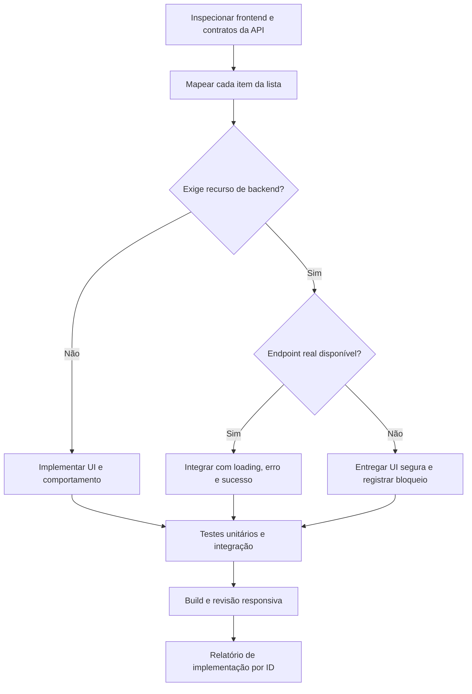
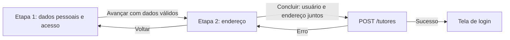
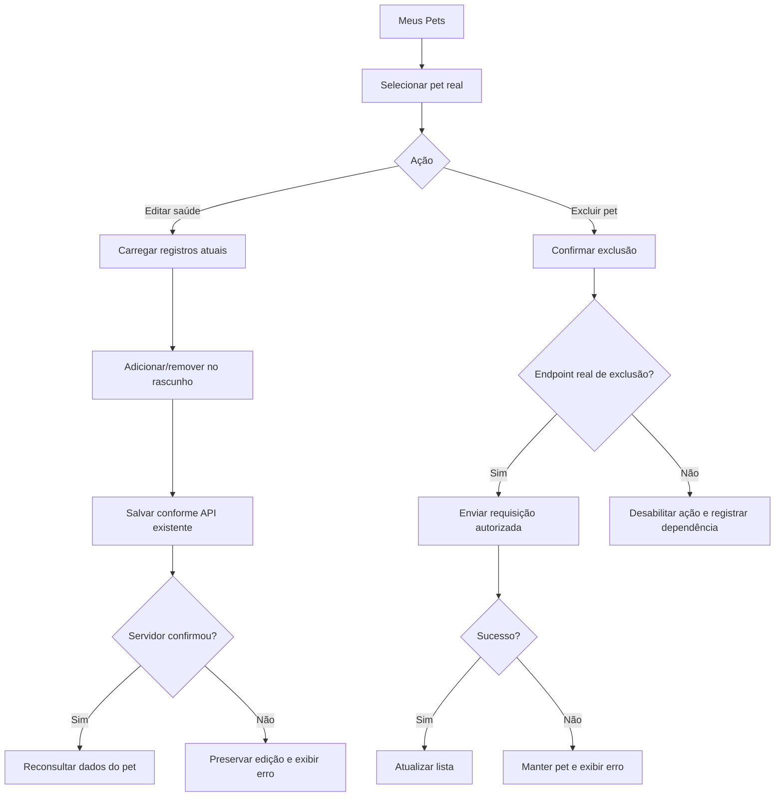
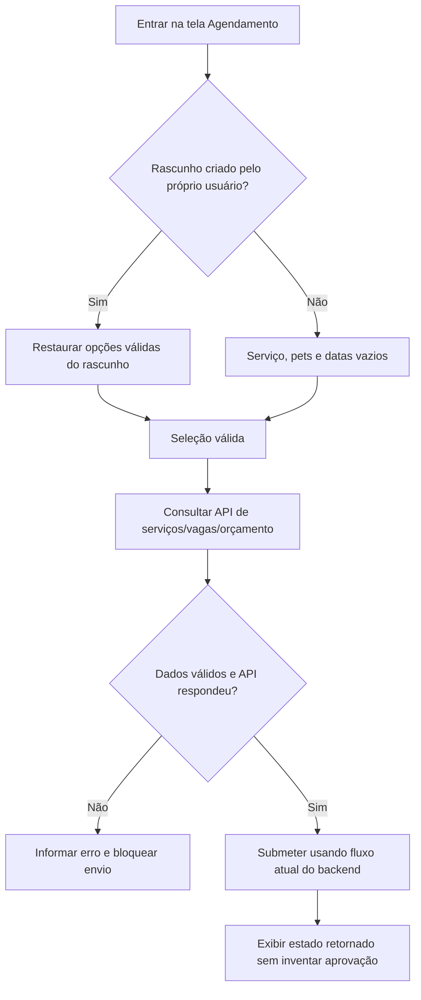

# SPEC — Correções e ajustes exclusivamente no frontend | EcoDog

**Versão:** 1.1 — 06/11/2026  
**Destinatário:** agente de IA responsável por implementar mudanças no repositório  
**Origem:** `atividades_frontend_backend(1).md`, código disponibilizado em `EcoDog.zip` e análise anterior `Propostas_Regra_de_Negocio_EcoDog.md`  
**Escopo obrigatório:** `frontend/` — **não alterar backend, banco, contratos de API nem regras de autorização do servidor.**

## Atualização de requisitos — 06/11/2026

- Cadastro público inicial: criar exclusivamente tutor com `POST /tutores`.
- Gestão de funcionários na seção do administrador: disponibilizar dois botões distintos, “Adicionar monitor” e “Adicionar administrador”, enviando respectivamente `POST /monitores` e `POST /administradores`.
- Os três POSTs enviam os dados obrigatórios do usuário e um objeto aninhado `endereco` com os dados de endereço na mesma requisição. Não criar primeiro a conta e depois enviar o endereço em chamada separada.
- O perfil é determinado pelo endpoint; o cadastro público não oferece criação de monitor ou administrador. A autorização das ações administrativas deve ser garantida pelo servidor.
- Esta definição substitui o requisito anterior de cadastro via `POST /usuarios` e o bloqueio baseado no DTO antigo sem endereço. Disponibilidade, campos exatos, validações e respostas dos novos contratos ainda precisam ser verificados antes da integração; esta atualização documental não comprova implementação.

## Status atual de desenvolvimento — revisão em 03/11/2026, com requisitos atualizados em 06/11/2026

Esta seção registra o estado encontrado no código, nos testes e em `Relatorio_Correcoes_Frontend_EcoDog.md`. Os requisitos abaixo continuam válidos: uma interface pronta ou uma ação desabilitada não representa uma integração concluída.

**Resumo: 16 concluídas, 8 incompletas e 1 não inicializada quanto à entrega solicitada (bloqueada por dados).** A task ADM-03 foi investigada e recebeu proteção contra nomenclatura enganosa, mas a distribuição de pets solicitada ainda não foi implementada. Portanto, não há task sem qualquer análise ou tratamento; “não inicializada” abaixo refere-se à implementação da entrega funcional.

| ID | Status atual | Entrega existente e pendência |
|---|---|---|
| GLO-01 | CONCLUÍDA | Hífens isolados corrigidos nas strings conhecidas, preservando dados técnicos e da API. |
| AUT-01 | INCOMPLETA | Fluxo em duas etapas, validação, voltar e submissão única prontos na revisão anterior. Pendente migrar para `POST /tutores`, enviando dados do usuário e objeto `endereco` juntos, conforme definição de 06/11/2026. Verificar o novo DTO e integrar o endereço real. |
| AUT-02 | INCOMPLETA | Tela pública, link no login, validação de e-mail e retorno prontos. Falta endpoint de recuperação; nenhum e-mail é enviado. |
| AUT-03 | CONCLUÍDA | Consulta autenticada dos dados reais disponíveis (nome, e-mail e telefone), com loading, erro e somente leitura. CPF/endereço não retornados; edição indisponível por limitação do contrato. |
| PET-01 | INCOMPLETA | Criação com Sim/Não e envio booleano explícito pronta. Edição segura depende de consulta integral do pet. |
| PET-02 | INCOMPLETA | Seletor, adicionar, cards e campos específicos uniformizados. Faltam catálogos reais de saúde; controles indisponíveis no modo real. |
| PET-03 | CONCLUÍDA | Seleção inicial vazia, adicionar protegido, prevenção de duplicidade e limpeza após inclusão. A disponibilidade dos catálogos permanece pendência de PET-02. |
| PET-04 | INCOMPLETA | Remoção local pelos cards e proteção contra envio destrutivo de listas vazias prontas. Falta consulta integral de saúde para persistir edição com segurança. |
| PET-05 | CONCLUÍDA | DELETE autenticado com ID real, confirmação pelo nome, loading, prevenção de duplo clique, erro preservando card e recarga após sucesso. |
| AGE-01 | CONCLUÍDA | Acesso direto inicia com serviço, pets e datas vazios; rascunho explícito preservado e consultas incompletas evitadas. |
| AGE-02 | CONCLUÍDA | Navegação limitada pelo mês/ano atual, incluindo virada do ano, e proteção contra datas passadas. |
| CAL-01 | CONCLUÍDA | Bloco “Disponibilidade do dia” removido, mantendo capacidade e operações do calendário. |
| MON-01 | CONCLUÍDA | Agrupamento por grupo real e duração em minutos calculada dos horários; ausência de dados tratada sem inventar duração. |
| MON-02 | CONCLUÍDA | “Diário do Pet” padronizado; rota existente preservada. |
| MON-03 | CONCLUÍDA | Feedback acessível somente após resposta positiva, erro preservando formulário e proteção contra repetição. Timeout do Axios validado por testes unitários; E2E cobre envio pendente, duplo clique e falha de rede. Persistência com backend ativo ainda requer validação adicional. |
| MON-04 | CONCLUÍDA | Feed removido da navbar do monitor; acesso contextual e página preservados. |
| ADM-01 | INCOMPLETA | Editor de mês/ano pronto, reutilizando data exata de meta real quando disponível. Falta convenção mensal aprovada ou API de consulta por mês para completar o fluxo. |
| ADM-02 | INCOMPLETA | Referências reais filtradas pelo serviço e seleção incompatível invalidada. Falta esclarecer “datas correspondentes” e garantir os dados necessários. |
| ADM-03 | NÃO INICIALIZADA — BLOQUEADA | Distribuição de pets não implementada. A análise confirmou que a fonte conta contratos; o título de contratos foi preservado. Falta fonte/agregação real de pets para iniciar a entrega sem rotular dados incorretamente. |
| ECO-01 | INCOMPLETA | Link seguro para WhatsApp e estado indisponível implementados, sem fluxo Twilio na ação. Falta número oficial em `VITE_WHATSAPP_NUMBER`; mensagem opcional em `VITE_WHATSAPP_MESSAGE`. |
| ECO-02 | CONCLUÍDA | Ícone ampliado, proporcional, com área de clique e ajustes responsivos. |
| FOO-01 | CONCLUÍDA | Iframe oficial do Google Maps fornecido e autorizado pelo usuário incorporado à coluna Localização, responsivo, sem borda, com título acessível, lazy loading e referrer policy. Link adicional opcional por env. |
| FOO-02 | CONCLUÍDA | Logo oficial existente reutilizada com proporção, alt e tamanho responsivo. |
| FOO-03 | CONCLUÍDA | URL oficial fornecida pelo usuário configurada; links Instagram e @ecodogpark abrem com `noopener noreferrer`. Substituição opcional em `VITE_INSTAGRAM_URL`. |
| FOO-04 | CONCLUÍDA | Ajuda removida somente dos footers de monitor/admin, preservando o institucional público. |

### Evidências e limites desta revisão

- `npm test`: **176 testes aprovados em 32 arquivos**, reexecutados nesta revisão.
- `npm run build`: **aprovado**, reexecutado nesta revisão; permanecem avisos de imagens resolvidas em runtime e chunk principal acima de 500 kB.
- `npm run test:e2e -- tests/e2e/frontend-corrections.spec.js`: **10 E2E aprovados**, reexecutados nesta revisão com respostas controladas da API. Não comprovam persistência em backend ativo. Timeout do Axios foi simulado nos testes unitários; o E2E usa interrupção de rede, não espera os 20 segundos reais do timeout.
- Complementos desta execução: mensagem específica de timeout sem confirmação de persistência ou repetição automática (MON-03), testes de cancelamento/duplo clique/falha de rede e associação explícita dos labels nos campos de saúde sem labels aninhados (PET-02/04). As dependências externas foram reconfirmadas por leitura dos contratos; nenhuma task parcial/bloqueada foi promovida a concluída.
- O status CONCLUÍDA indica atendimento da task no frontend conforme a evidência disponível, não conclusão de funcionalidades ausentes no backend nem homologação completa em produção.
- Para completar as tasks incompletas/bloqueadas, priorizar: suporte a endereço e recuperação; consulta integral e catálogos de saúde dos pets; contrato mensal e significado das datas de metas; fonte de contagem de pets; confirmação dos contatos oficiais.

## 0. Objetivo e contrato de execução da IA

Implementar os ajustes da lista recebida **somente no frontend React + Vite do EcoDog**, preservando o funcionamento de login, cadastro, pets, reservas, monitor e administrador. O foco é tornar a experiência de uso coerente e integrar somente operações efetivamente suportadas pelo backend existente.

### Regras mandatórias

1. Antes de editar, revisar o estado **atual** do repositório; os caminhos e comportamentos mencionados abaixo foram identificados no ZIP de referência e podem ter mudado.
2. **Não editar** `backend/`, migrações, SQL, controladores, services Java, entidades, `pom.xml` ou contratos de resposta do servidor.
3. Usar a arquitetura atual (`views/screens`, `views/components`, `views/design`, `viewmodels`, `api`, `models`) e evitar uma reescrita ampla de `ScreenPage.jsx`.
4. Não inventar endpoints, campos de DTO, dados de negócio, preço, endereço, Instagram, link do WhatsApp ou coordenadas. Inspecionar controladores/DTOs existentes **somente para leitura**. Se não houver suporte na API, criar UI acessível com mensagem honesta de indisponibilidade, desabilitar a ação dependente ou registrar bloqueio — **nunca exibir sucesso falso**.
5. Chamadas que criam, excluem ou atualizam dados devem ter loading, tratamento de erros, confirmação quando destrutivas, prevenção de duplo clique, e atualização da lista após sucesso.
6. Reutilizar `requestJson`, sessão/token e padrões existentes de autenticação; não enviar credenciais por query string e não expor token em logs.
7. Preservar responsividade, foco de teclado, labels, mensagens de erro e estados vazios. Não remover funcionalidades necessárias por causa de uma mudança de nomenclatura.
8. Não marcar funcionalidades de backend como concluídas só porque a aparência está pronta.
9. Escrever/ajustar testes e executar `npm test` e `npm run build` dentro de `frontend/`; se existir ambiente E2E configurado, executar os testes pertinentes ou documentar impedimento.
10. Entregar ao final resumo dos arquivos alterados, itens concluídos/parciais/bloqueados, evidências de testes e dependências de backend/negócio que precisam de decisão.
11. **Preservar a identidade visual estabelecida**, inclusive nas tasks incompletas: reutilizar composição, cores, fontes, assets, cards e controles dos layouts existentes. Novas etapas, links e avisos devem ser integrados ao visual original, nunca substituí-lo por páginas ou footers genéricos. Validar cadastro e footer institucional em desktop/mobile.

### Limite do trabalho frente à análise anterior de agendamentos

A análise do projeto identificou acoplamento entre contrato, movimentação e agendamento e sugeriu separar solicitação e reserva. **Isso não é parte desta SPEC de correções da lista**: não implementar nova regra de aprovação, fluxo de contraproposta, status de solicitação ou ocupação de vagas somente via frontend. A correção de formulário/calendário abaixo deve respeitar APIs e semântica atualmente existentes, sem aparentar que tais problemas de negócio foram resolvidos.

## 1. Mapa de pontos do frontend já identificados

| Área | Arquivos/pontos de partida observados no ZIP |
|---|---|
| Composição de páginas e handlers | `frontend/src/views/screens/ScreenPage.jsx` |
| Rotas e proteção por perfil | `frontend/src/App.jsx`, `frontend/src/views/screens/catalog.js` |
| Layouts e conteúdo gerado de telas | `frontend/src/views/design/` e arquivos importados pelo renderer |
| Cadastro/login | `frontend/src/models/auth.js`, `frontend/src/viewmodels/auth.js`, `frontend/src/views/design/auth.js` |
| Pets | `frontend/src/api/pets-api.js`, `frontend/src/models/pet-registration.js`, `frontend/src/viewmodels/pet-draft.js`, `frontend/src/views/components/TutorPets.jsx`, `frontend/src/views/components/PetAllergies.jsx`, `frontend/src/views/components/PetCatalogDialog.jsx` |
| Agendamento | `frontend/src/api/tutor-booking.js`, `frontend/src/views/components/BookingDates.jsx`, `frontend/src/viewmodels/booking-draft.js` |
| Calendário administrativo | `frontend/src/views/components/ManagementCalendar.jsx`, `frontend/src/viewmodels/use-management-calendar.js` |
| Monitor / diário | `frontend/src/viewmodels/use-monitor-feed.js`, `frontend/src/viewmodels/use-pet-diary.js`, `frontend/src/api/monitor-feed-api.js`, `frontend/src/api/pet-diary-api.js` |
| Metas e dashboard | `frontend/src/viewmodels/use-dashboard.js`, `frontend/src/api/dashboard-api.js`, `frontend/src/views/design/dashboard.js` |

**Achados confirmados no código de referência:**
- `ScreenPage.jsx` inicializa `service` como `'Hotel'` e usa seleções ilustrativas de pets (`['Thor','Mel','Luke']`), que não devem aparecer como seleção real padrão.
- `ScreenPage.jsx` abre `dialog === 'profile'` para “Meus Dados”, exibindo um placeholder sobre dependência da autenticação.
- No código de referência, o cadastro usa `createAuthViewModel(api).register(fields)` e `models/auth.js` envia `POST /usuarios`; a definição de 06/11/2026 exige migrar a criação pública para `POST /tutores` com `endereco` aninhado.
- O cadastro/edição de pet já manipula `convenio` como booleano ao ler, convertendo para “Sim/Não” na interface.
- `api/pets-api.js` tem um método de **listagem**; a existência do método de exclusão precisa ser confirmada em todos os módulos e no backend.
- A mensagem “Registro salvo no sistema.” já aparece em um fluxo de monitor (`ScreenPage.jsx`); verificar se ela é visualmente percebida e se todos os registros do Diário do Pet passam pelo mesmo fluxo.
- O catálogo de telas contém `TL10` denominado “Feed do Monitor” na rota `/monitor/feed`, e o menu monitor inclui `TL10`.

## 2. Fluxo de execução e validação

**Ordem recomendada:** infraestrutura/visual global → cadastro/perfil → pets → agendamento/calendário → monitor → administrador → EcoMigo/footers → testes completos.

## 3. Backlog técnico detalhado e critérios de aceite

### GLO-01 — Remover hífens indesejados dos textos gerados pelo ChatGPT

**Origem:** “Todas telas”.  
**Execução:** inventariar strings e arquivos de conteúdo estático de autoria do projeto, inclusive layouts/designs. Remover apenas hífens usados como artefato de formatação em textos visíveis; reescrever frases quando apropriado. **Não** remover sinais de subtração, hífens em palavras corretas, telefones, URLs, rotas, identificadores, data ISO, CSS, código, `aria-*`, markdown intencional ou valores retornados pela API.  
**Aceite:** textos de UI não exibem `-` isolado indevido; elementos técnicos continuam corretos; não criar um `replaceAll('-','')` global.  
**Teste:** exemplos de título, lista textual, data, link e número negativo.

### AUT-01 — Cadastro de usuário em duas etapas, com endereço na segunda

**Origem:** “Cadastro de usuário”.  
**Execução:** etapa 1 com dados pessoais e de acesso já exigidos; etapa 2 com endereço. Prover “Voltar” sem perder dados, validação por etapa, indicador de progresso e submissão **única** ao final para `POST /tutores`. Enviar os dados obrigatórios do usuário e o objeto aninhado `endereco` na mesma requisição, sem POST prévio para `/usuarios` nem chamada separada para salvar endereço. Confirmar nomes, tipos e obrigatoriedade dos campos no novo DTO; não enviar chaves arbitrárias. Confirmação de senha é validação local. Preservar redirecionamento para login após sucesso.  
**Aceite:** não submete na transição entre etapas; estado preservado ao navegar; validações aparecem na etapa correta; endpoint recebe payload compatível; resposta de erro mantém dados para correção; funciona no mobile.  
**Teste:** validação, voltar/avançar, payload e resposta de erro.

### AUT-02 — Tela “Esqueceu a senha”

**Execução:** criar rota pública e link de acesso na tela de login; formulário com e-mail e validação; confirmar no backend se existe endpoint de recuperação de senha e seu contrato. Se disponível, integrar com estado de envio e mensagem genérica de confirmação (não revelar existência de conta). Se indisponível, entregar tela navegável informando de forma clara que o envio de recuperação ainda não está disponível; **não simular disparo de e-mail ou oferecer redefinição local insegura**. Não inventar tokens/fluxo de redefinição.  
**Aceite:** rota acessível por link do login; e-mail inválido bloqueado; mensagem verdadeira; voltar ao login; sem vazamento de existência de usuários.  
**Dependência:** endpoint de solicitação e, se aplicável, redefinição de senha, a verificar.

### AUT-03 — Tela “Meus Dados”

**Execução:** substituir o placeholder de perfil por visualização de dados reais da sessão e/ou endpoint autenticado existente. Criar página ou seção dedicada acessível por menu; exibir nome, e-mail, telefone, CPF e endereço **somente se devolvidos pela API**, com estados carregando/erro/ausência. Se houver endpoint real de edição, permitir alteração apenas dos campos suportados; senão, manter somente leitura e indicar a limitação. Nunca reconstruir perfil apenas de claims JWT se estes não oferecem tais dados.  
**Aceite:** usuário autenticado visualiza somente seus dados; sem mocks nem edição fictícia; perfil não acessível anonimamente; logout/expiração tratados corretamente.  
**Dependência:** consulta e eventual atualização do próprio usuário no backend.

### PET-01 — Convênio como Sim/Não

**Execução:** adotar controle acessível Sim/Não em criação e edição; mapear explicitamente para `true`/`false` no payload conforme o contrato existente, nunca strings “Sim”/“Não” no envio. Não tornar obrigatório sem regra já existente.  
**Aceite:** leitura, edição e criação coerentes; nenhuma conversão por verdade de string (`Boolean('Não')` é verdadeiro).  
**Teste:** transições true/false e valor não informado, se permitido.

### PET-02 — Uniformizar adição de vacinas, alergias e medicamentos

**Execução:** padronizar seletor, ação “Adicionar”, cards de itens adicionados, ações de remover, mensagens e espaçamento, respeitando campos distintos (por exemplo, vacina com data, medicação com dosagem/frequência). Reutilizar componentes genéricos sem perder semântica específica.  
**Aceite:** três seções visualmente consistentes, sem perda de informações obrigatórias; acessíveis por teclado; funcionam em cadastro e edição.

### PET-03 — Só adicionar item selecionado

**Execução:** iniciar cada seletor sem seleção automática; botão “Adicionar” desabilitado até seleção válida; impedir inclusão duplicada se a regra atual não permitir; limpar seleção após adicionar. Não adicionar valores apenas ao focar/clicar no seletor.  
**Aceite:** clique em “Adicionar” sem seleção não muda estado; valor válido gera exatamente um card; validação condizente com o catálogo.  
**Teste:** estado inicial, seleção, duplicidade e limpeza.

### PET-04 — Remover itens pelos cards

**Execução:** adicionar botão “Remover [nome]” em cada card de vacina, alergia e medicação. Remover apenas do **rascunho** local até salvar cadastro/edição, sem chamadas de exclusão isoladas não suportadas. Na edição, preservar registros pré-existentes carregados da API e tomar cuidado com o fluxo já observado que pode iniciar listas de saúde vazias caso a consulta não as retorne. Não enviar listas vazias que apaguem inadvertidamente os dados de saúde existentes.  
**Aceite:** exclusão do card correto, sem alterar outros itens; alterações persistidas somente pelo mecanismo real da edição; não perder dados por resposta incompleta.  
**Teste:** adicionar/remover/cancelar edição; resposta parcial da API.

### PET-05 — Excluir pet em “Meus Pets”

**Execução:** em cada pet identificado com ID real, incluir ação de exclusão com modal de confirmação contendo o nome. Localizar endpoint de exclusão real e usar autenticação da sessão; integrar método no módulo de API adequado. Em sucesso, recarregar lista/retirar card e limpar seleções que apontavam ao pet. Em erro (inclusive pet com vínculo que bloqueia exclusão), manter card e mostrar mensagem; não ocultar registro localmente como se a exclusão tivesse acontecido. Se não houver endpoint, deixar ação indisponível com justificativa e registrar bloqueio.  
**Aceite:** não exclui sem confirmação; usa identificador real; loading; feedback correto; lista atualizada; erros tratados.  
**Dependência:** DELETE/soft-delete de pet no backend, a verificar.

### AGE-01 — Iniciar agendamento sem serviço/pet/data selecionados

**Execução:** remover padrão `'Hotel'` e qualquer pet ilustrativo pré-selecionado em modo real, garantindo placeholder “Selecione um serviço”, lista de pets desmarcada e datas vazias. Respeitar deliberadamente um rascunho salvo pelo próprio usuário (por exemplo, vindo de “Estrutura”): pré-seleção por **ação expressa do usuário** é distinta de seleção arbitrária inicial. Não buscar disponibilidade/orçamento até as entradas mínimas necessárias.  
**Aceite:** acesso direto a `/tutor/agendamento` começa vazio; botão de confirmar não permite estado incompleto; rascunho explícito pode restaurar seleção; nenhuma chamada inválida por `service=''`.  
**Teste:** acesso direto, retorno com rascunho, seleção/limpeza.

### AGE-02 — Bloquear navegação para meses anteriores ao atual

**Execução:** implementar limite por **ano/mês de calendário**, não por um offset fixo presumido. No `ScreenPage.jsx` de referência há cálculo baseado em agosto de 2026; transformar a comparação para o mês real atual. Desabilitar a seta anterior, inclusive pelo teclado, quando mês exibido = mês vigente; impedir qualquer atualização de estado para mês anterior. Ao avançar para mês futuro, permitir voltar até o mês atual. Datas anteriores ao dia atual devem permanecer indisponíveis mesmo dentro do mês atual quando a regra já proíbe reserva retroativa.  
**Aceite:** funciona na troca de ano, inclusive dezembro→janeiro; não exibe mês anterior pelo botão; seleção de datas passadas protegida.  
**Teste:** datas simuladas e transição de ano.

### CAL-01 — Remover “Disponibilidade do dia” do gerenciamento de calendário

**Execução:** retirar o texto, bloco ou indicador especificamente nomeado “Disponibilidade do dia” na UI administrativa. Manter controles de capacidade, detalhes de agenda, avisos de lotação e chamadas usados por outras funcionalidades, salvo se o item for exclusivamente decorativo.  
**Aceite:** rótulo/bloco ausente; demais informações de calendário e operações preservadas.

### MON-01 — Duração das atividades em minutos, agrupadas por grupo

**Execução:** na tela “Atividades do dia” (`TL12`), agrupar por campo de grupo retornado pelo fluxo real (identificar shape no viewmodel/API). Exibir duração em minutos convertendo **apenas** de uma unidade comprovada (ex.: `hora_fim - hora_inicio`, com tratamento de virada do dia se aplicável). Não inventar duração se API não fornecer nem permitir cálculo. Para ausência de grupo, usar “Sem grupo” ou rótulo equivalente.  
**Aceite:** agrupamento estável, duração `NN min`, itens sem grupo e sem duração tratados; nenhum dado sintético misturado com API.  
**Dependência:** formato de tempo e identificador de grupo do backend.

### MON-02 — Padronizar a nomenclatura e interface “Diário do Pet”

**Execução:** revisar títulos, botões, breadcrumbs, mensagens, links e acessibilidade de feed/diário; tornar “Diário do Pet” o nome exibido nas experiências pertinentes, distinguindo a visão do tutor (`TL07`) da entrada do monitor (`TL10`) quando necessário. Melhorar consistência visual e leitura dos registros; não trocar a semântica de dados nem remover funcionalidades do monitor ao renomear. A rota existente pode permanecer por compatibilidade caso não haja necessidade funcional de renomear URL.  
**Aceite:** cliente vê “Diário do Pet”; monitor identifica claramente onde registra informações; nenhum link quebrado por mudança de nome.

### MON-03 — Confirmação de salvamento no Diário do Pet

**Execução:** após resposta positiva do serviço de gravação, mostrar toast ou mensagem de sucesso visível e anunciada por `role="status"`/`aria-live`; em erro, mostrar falha, preservar o formulário para nova tentativa e não indicar sucesso. O código de referência já mostra “Registro salvo no sistema.” em um fluxo de monitor: investigar por que o usuário não percebe o retorno e reaproveitar se possível.  
**Aceite:** confirmação somente após persistência real; sem confirmação em preview/memória confundida com servidor; ação repetida protegida.  
**Teste:** sucesso, erro, timeout e estado de prévia.

### MON-04 — Remover acesso ao feed da navbar do monitor

**Execução:** retirar entrada `TL10` da navegação principal do monitor (`catalog.js`/componentes de menu), mas preservar o acesso contextual necessário para monitor registrar o Diário do Pet a partir do pet/atividade, se ainda for obrigatório para o fluxo. Não excluir a página nem quebrar links existentes.  
**Aceite:** menu do monitor não apresenta “Feed”; ações contextuais de registro continuam acessíveis.

### ADM-01 — Metas: seletor somente mês e ano

**Execução:** em edição de metas no dashboard (`TL13`), substituir controles de data diária por seleção de mês e ano; normalizar entrada para formato aceito pela API, sem alteração no backend. Se API exigir data completa, usar convenção já existente no backend (por exemplo, primeiro dia do mês **somente se comprovado**).  
**Aceite:** usuário não precisa selecionar dia; meta recuperada exibe mês/ano certo; persistência usa DTO existente; ano da virada testado.  
**Dependência:** contrato de `mes_referencia` da API.

### ADM-02 — Metas: apresentar datas do serviço/meta selecionados

**Execução:** no editor/detalhe da meta, associar seleção real de serviço e meta aos meses/datas de referência pertinentes, a partir de dados retornados ou de regras comprovadas. Atualizar informação reativamente; manter estados vazios; não fabricar períodos de metas nem apresentar datas sem fonte.  
**Aceite:** trocar seleção altera datas mostradas de modo consistente; datas corretas para serviço/meta; nenhuma data hardcoded.  
**Dependência:** interpretação de “datas correspondentes” pela equipe e dados disponíveis no backend (marcar como decisão pendente se ambíguo).

### ADM-03 — “Distribuição de Contratos” → “Distribuição de Pets”

**Execução:** trocar título, label, texto alternativo e referência visual relevante para “Distribuição de Pets”. **Antes de renomear, verificar que os números exibidos são realmente contagens de pets**; se representam contratos, não rotular incorretamente: adaptar a agregação com dados existentes se possível, ou registrar bloqueio de dados.  
**Aceite:** título correto **e semântica dos dados correspondente**; demais gráficos do dashboard intactos.

### ADM-04 — Gestão de funcionários: cadastrar monitor e administrador com endereço

**Origem:** atualização de 06/11/2026, tela de gestão de funcionários na seção administrativa (TL15).  
**Status:** PENDENTE — novo requisito, fora da contagem histórica dos 25 itens.  
**Execução:** disponibilizar dois botões distintos, “Adicionar monitor” e “Adicionar administrador”. Cada ação abre o formulário correspondente, coleta os dados obrigatórios do usuário e endereço e envia uma única requisição: `POST /monitores` ou `POST /administradores`, respectivamente, com objeto aninhado `endereco`. Reutilizar o padrão visual e as validações do cadastro sem presumir que os DTOs dos três perfis sejam idênticos. Não usar `/usuarios` nem salvar endereço em chamada posterior. Preservar autenticação administrativa e verificar autorização no servidor.  
**Aceite:** os dois botões estão disponíveis na gestão de funcionários; cada um utiliza a rota correta; endereço acompanha os dados do usuário; loading e prevenção de duplo clique; erro preserva o formulário; sucesso somente após resposta positiva e atualização da lista. Cadastro público continua exclusivo para tutores.  
**Teste:** botão/perfil/endpoint corretos, payload com `endereco`, validações, falha preservando dados, envio único e atualização após sucesso.  
**Dependência:** disponibilidade e DTOs dos novos POSTs, respostas e permissões administrativas.

### ECO-01 — EcoMigo abre WhatsApp diretamente, sem fluxo Twilio

**Execução:** substituir ação do ícone EcoMigo por link `https://wa.me/<numero>` com número internacional **configurável** em env/arquivo de configuração do frontend e mensagem predefinida opcional codificada com `encodeURIComponent`. Não inserir número fictício ou de desenvolvedor. Se o número oficial ainda não foi fornecido, mostrar ação indisponível claramente e registrar configuração necessária. Para abertura em nova aba, `rel="noopener noreferrer"`. Não criar chatbot local e não alterar componentes de backend/Twilio; remover apenas dependência visual/de navegação da UI.  
**Aceite:** clique abre URL segura do WhatsApp quando configurado; em ausência de configuração, não abre destino incorreto; acessível no mobile e desktop.  
**Dependência:** número oficial de atendimento.

### ECO-02 — Ampliar o ícone EcoMigo

**Execução:** aumentar tamanho visível mantendo proporção, área de clique acessível (mínimo recomendado 44×44px), posição e responsividade; evitar sobreposição de conteúdo e footer.  
**Aceite:** ícone maior em telas pequenas/grandes; foco visível; não obstrui botões.

### FOO-01 — Adicionar Google Maps ao footer institucional

**Execução:** adicionar link acessível “Como chegar / Ver no Google Maps” para **endereço oficial confirmado** ou embed apenas se autorizado e configurado. Priorizar link em vez de embed para evitar dependência desnecessária de chave/API; se endereço não existir na configuração do projeto, deixar marcador de configuração sem localização inventada.  
**Aceite:** URL direciona à localização correta quando configurada; abre de forma segura; footer responsivo.  
**Dependência:** endereço ou link oficial do estabelecimento.

### FOO-02 — Melhorar exibição da logo no footer

**Execução:** localizar asset oficial já existente; ajustar tamanho máximo, proporção, contraste e alinhamento; usar `object-fit: contain`, atributo alt apropriado e variações responsivas. Não criar ou substituir identidade visual sem pedido.  
**Aceite:** sem distorção, corte ou pixelização evidente; tema e contraste adequados.

### FOO-03 — Link para Instagram

**Execução:** adicionar ícone/texto com URL oficial configurável, label acessível e abertura segura de link externo. Não supor perfil do projeto.  
**Aceite:** destino correto se configurado; estado ausente não redireciona a perfil de terceiros.  
**Dependência:** URL oficial do Instagram.

### FOO-04 — Remover “Precisa de ajuda?” dos footers do monitor e administrador

**Execução:** retirar somente essa ação/texto nos layouts autenticados de monitor/admin, mantendo as informações e os links úteis existentes. Verificar variantes desktop/mobile.  
**Aceite:** frase/atalho ausente nos dois perfis e nenhum espaço vazio indevido; footer institucional público não sofre remoções acidentais.

## 4. Matriz de implementação e dependências

Legenda: **FE** = realizável somente no frontend; **API?** = exige verificar suporte; **CONTEÚDO** = depende de informação oficial do projeto.

| ID | Prioridade sugerida | Natureza | Condição de conclusão |
|---|---|---|---|
| GLO-01 | P2 | FE | Revisão de copy concluída |
| AUT-01 | P1 | FE + API? | `POST /tutores` integrado com usuário e `endereco` no mesmo payload |
| AUT-02 | P1 | FE + API? | Tela pronta; envio somente se endpoint existir |
| AUT-03 | P1 | FE + API? | Dados reais disponíveis |
| PET-01 | P1 | FE | Booleano enviado corretamente |
| PET-02 | P1 | FE | Padrão visual e campos específicos preservados |
| PET-03 | P1 | FE | Sem adição sem seleção |
| PET-04 | P1 | FE + API? | Sem perda de registros pré-existentes |
| PET-05 | P1 | FE + API? | Exclusão real ou bloqueio explícito |
| AGE-01 | P1 | FE | Estado inicial vazio, sem regressão do rascunho |
| AGE-02 | P1 | FE | Meses anteriores inacessíveis |
| CAL-01 | P2 | FE | Remoção visual sem perder operações |
| MON-01 | P2 | FE + API? | Duração e grupo amparados pelos dados |
| MON-02 | P2 | FE | Nome e UX padronizados |
| MON-03 | P1 | FE | Feedback corresponde ao resultado real |
| MON-04 | P2 | FE | Menu sem feed e fluxo contextual preservado |
| ADM-01 | P2 | FE + API? | Persistência em formato aceito |
| ADM-02 | P2 | FE + API? | Datas fundamentadas em dados reais |
| ADM-03 | P2 | FE + API? | Gráfico mede pets, não contratos |
| ADM-04 | P1 | FE + API? | Dois botões integrados a `POST /monitores` e `POST /administradores`, ambos com `endereco` |
| ECO-01 | P1 | FE + CONTEÚDO | Número oficial configurado |
| ECO-02 | P2 | FE | Botão legível e acessível |
| FOO-01 | P3 | FE + CONTEÚDO | Endereço/link oficial configurado |
| FOO-02 | P3 | FE | Logo oficial corretamente apresentada |
| FOO-03 | P3 | FE + CONTEÚDO | Instagram oficial configurado |
| FOO-04 | P3 | FE | Removido de ambos os perfis |

**Prioridades sugeridas pela análise, não definidas na lista original.**

## 5. Fluxos críticos que não podem regredir

## 6. Estratégia de testes e qualidade

Para cada ID implementar ao menos uma validação automatizada pertinente; priorizar testes de lógica/mapeamento e smoke tests de telas críticas.

- **Cadastro:** segunda etapa com endereço, voltar sem perder campos, payload real de `POST /tutores` com `endereco` aninhado, não submeter duas vezes.
- **Funcionários:** dois botões, POST correto por perfil (`/monitores` ou `/administradores`), usuário e endereço juntos, erros e atualização da lista.
- **Recuperação/perfil:** rota pública x protegida; API ausente; erro/sucesso corretos.
- **Pets:** booleano, listas dinâmicas, remoção local e proteção contra apagamento acidental; exclusão confirmada com erro do servidor.
- **Agendamento:** início vazio; rascunho explícito; bloqueio de mês anterior, inclusive mudança de ano; orçamento só com parâmetros válidos.
- **Monitor:** agrupamento e cálculo de duração a partir dos dados; feedback de persistência; menu sem “Feed” e registros acessíveis por contexto.
- **Admin:** mês/ano, datas correspondentes, consistência entre métrica e título de “Distribuição de Pets”.
- **EcoMigo/footers:** números/links configurados, ausência segura de configuração, acessibilidade e mobile.
- **Regressão:** `npm test`, `npm run build`; executar `npm run test:e2e` quando o ambiente de testes suportar, reportando a execução real.

## 7. Critérios globais de aceite (Definition of Done)

- [ ] Arquivos alterados limitados a `frontend/` (salvo arquivo de relatório explicitamente solicitado na raiz).
- [ ] Todos os 25 itens originais e o requisito adicional ADM-04 possuem status claro: `CONCLUÍDO`, `PARCIAL` ou `BLOQUEADO`.
- [ ] UI não mostra dados simulados como dados reais e não confirma ações que não persistiram no servidor.
- [ ] Sem regressões graves em cadastro/login, pets, agendamento, monitor e dashboard.
- [ ] Tratamento de loading/erro e acessibilidade para cada operação nova.
- [ ] Testes e build executados; falhas reportadas com comando e causa.
- [ ] Dependências externas (API, número WhatsApp, perfil Instagram, endereço Maps, significado de datas de meta) documentadas.
- [ ] Nenhuma regra de aprovação/contrato modificada somente no frontend.

## 8. Prompt de execução pronto para agente de IA

> Você é um agente de desenvolvimento frontend atuando no repositório EcoDog (React/Vite). Leia integralmente esta SPEC e a lista original de atividades. Inspecione os arquivos **atuais** do projeto antes de codificar, usando o ZIP e o levantamento anterior apenas como contexto. Implemente os IDs GLO-01 até FOO-04 **exclusivamente em `frontend/`**, sem modificar o backend ou criar endpoints fictícios. Faça mudanças pequenas e rastreáveis, preserve padrões de componentes existentes, integre apenas APIs reais, não crie sucesso falso nem dados mockados como se fossem definitivos. Para funcionalidades dependentes de backend/credenciais/URLs oficiais ausentes, implemente a parte segura e classifique como parcial ou bloqueada. Priorize consistência, acessibilidade e regressões. Adicione testes pertinentes e execute `npm test` e `npm run build`. Ao final, forneça uma tabela por ID (status, arquivos, testes, dependências), resumo técnico e decisões pendentes. **Não implemente a reestruturação de contratos/agendamentos da análise anterior**, porque está fora do escopo desta lista.

## 9. Registro de questões em aberto

Estas são **dependências a confirmar**, não permissão para a IA inventar respostas:

1. Quais endpoints reais existem para recuperação de senha, consulta/edição de perfil e exclusão de pet?
2. Quais são os campos, tipos, validações e respostas dos novos DTOs de `POST /tutores`, `POST /monitores` e `POST /administradores`, todos com objeto `endereco`? Quando estarão disponíveis e quais permissões protegem os cadastros de funcionários?
3. Qual a unidade da duração e a identificação de “grupo” nas atividades do monitor?
4. “Datas correspondentes à meta” significa vigência mês/ano, dias com receita/atendimento ou calendário do serviço?
5. Os dados de “Distribuição de Contratos” já contam pets ou será necessária fonte/agregação diferente?
6. Qual o número de WhatsApp do EcoMigo, link oficial de Instagram e localização oficial para Maps?
7. O fluxo de edição de pet retorna integralmente vacinas, alergias e medicações, evitando exclusão por sobrescrita?

---

**Nota metodológica:** esta SPEC foi derivada da lista recebida e de inspeção estática dos arquivos do ZIP. Os caminhos são referências para busca; o agente deverá verificar a versão efetiva do repositório e os contratos do backend antes de executar cada integração. Nenhuma correção do projeto foi realizada durante a produção deste documento.
